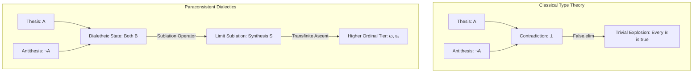

import DialecticalSpiralVisualizer from "../../../components/math/DialecticalSpiralVisualizer";

# From Cantor to Hegel: Formalizing Dialectics, Transfinite Ordinals, and Paraconsistent Logics in Lean 4

For over two centuries, Hegelian dialectics—the movement of thought through contradiction, negation, and sublation (*Aufhebung*)—has been simultaneously revered as a profound philosophical intuition and dismissed as logically vacuous mystification. The primary barrier to its mathematical formalization has always been the classical **Principle of Explosion** (*Ex Falso Quodlibet*): in classical logic, allowing a single contradiction $\textcolor{#a855f7}{A} \wedge \neg \textcolor{#a855f7}{A}$ immediately collapses the formal universe into triviality, proving that $0 = 1$ and obliterating all semantic distinctions.

However, modern mathematical logic possesses tools that Georg Wilhelm Friedrich Hegel could only dream of. By cross-pollinating **Cantor's transfinite ordinal arithmetic** with **paraconsistent type theories** in **Lean 4**, we can transform dialectical negation into an analytical, mechanically verifiable mathematical structure.

---

## I. The Dialectical Paradox & The Classical Collapse

In standard intuitionistic type theory (the foundation of Lean 4, Coq, and Agda), negation is defined constructively as an implication into the empty type:
$$
\neg \textcolor{#a855f7}{A} \equiv \textcolor{#a855f7}{A} \to \textcolor{#f43f5e}{\bot}
$$

Under the Curry-Howard correspondence, if an agent possesses both a proof of $\textcolor{#a855f7}{A}$ and a proof of $\neg \textcolor{#a855f7}{A}$, they can construct a term of the uninhabited type $\textcolor{#f43f5e}{\bot}$ (`False`). From $\textcolor{#f43f5e}{\bot}$, the `False.elim` rule produces a term of *any* arbitrary type $\textcolor{#3b82f6}{B}$:
$$
\textcolor{#a855f7}{A} \wedge \neg \textcolor{#a855f7}{A} \vdash \textcolor{#3b82f6}{B}
$$

In Lean 4, this is verified as an immediate tautology:

```lean
-- In standard Lean 4, contradiction instantly trivializes the system
theorem classical_explosion (A B : Prop) (h1 : A) (h2 : ¬A) : B :=
  False.elim (h2 h1)
```

For dialectical philosophy, where every finite determination contains the internal seed of its own negation (Thesis meets Antithesis), this classical explosion is catastrophic. Naïve dialectics in standard type theory is fatal: it does not yield a higher synthesis; it yields immediate triviality.

To formalize the dialectic without collapse, we must replace the classical explosive negation with an analytical framework that can host contradictory moments while strictly preserving informative structure.

---

## II. Cantorian Ordinals as Dialectical *Aufhebung*

Hegel's most rigorous critique of mathematics in the *Science of Logic* centers on the distinction between two infinities:
1.  **The Spurious Infinity (*Schlechte Unendlichkeit*):** The endless, repetitive $+1$ sequence of finite natural numbers ($\textcolor{#fbbf24}{n} \to \textcolor{#fbbf24}{n}+1$). It never actually reaches infinity; it merely flees from the finite in an unmediated, linear progression.
2.  **The True Infinity (*Wahrhafte Unendlichkeit*):** An affirmative, self-contained totality that does not stand opposed to the finite, but internalizes and sublates (*aufhebt*) the entire finite progression into a higher unity.

Georg Cantor's discovery of transfinite ordinals provides the exact mathematical realization of this distinction:

### 1. Successor Ordinals ($\textcolor{#fbbf24}{\alpha} + 1$) as Finite Transgression
A successor ordinal is formed by adjoining the set of all previous elements:
$$
\textcolor{#fbbf24}{\alpha} + 1 = \textcolor{#fbbf24}{\alpha} \cup \{\textcolor{#fbbf24}{\alpha}\}
$$
This mirrors the spurious infinity: each successor is bound to its predecessor by an identical, quantitative step.

### 2. Limit Ordinals ($\textcolor{#fbbf24}{\lambda}$) as Qualitative Sublation
A limit ordinal cannot be reached by applying the successor operation to any predecessor. Instead, it is defined as the supremum of all preceding ordinals:
$$
\textcolor{#fbbf24}{\lambda} = \bigcup_{\textcolor{#fbbf24}{\beta} < \textcolor{#fbbf24}{\lambda}} \textcolor{#fbbf24}{\beta}
$$

The first limit ordinal, $\textcolor{#fbbf24}{\omega} = \{0, 1, 2, 3, \dots\}$, is the quintessential mathematical *Aufhebung*:
*   **It Preserves (*conservare*):** Every finite natural number $\textcolor{#fbbf24}{n}$ belongs to $\textcolor{#fbbf24}{\omega}$.
*   **It Cancels (*tollere*):** None of the finite properties (e.g., finiteness itself) apply to $\textcolor{#fbbf24}{\omega}$.
*   **It Elevates (*elevare*):** $\textcolor{#fbbf24}{\omega}$ initiates a completely new, qualitative realm of transfinite arithmetic.

### 3. The Absolute Idea as Epsilon-Zero ($\textcolor{#fbbf24}{\varepsilon_0}$)
As we iterate transfinite powers ($\textcolor{#fbbf24}{\omega}, \textcolor{#fbbf24}{\omega}^{\textcolor{#fbbf24}{\omega}}, \textcolor{#fbbf24}{\omega}^{\textcolor{#fbbf24}{\omega}^{\textcolor{#fbbf24}{\omega}}}, \dots$), we arrive at the first fixed point of ordinal exponentiation:
$$
\textcolor{#fbbf24}{\varepsilon_0} = \textcolor{#fbbf24}{\omega}^{\textcolor{#fbbf24}{\varepsilon_0}} = \sup \{\textcolor{#fbbf24}{\omega}, \textcolor{#fbbf24}{\omega}^{\textcolor{#fbbf24}{\omega}}, \textcolor{#fbbf24}{\omega}^{\textcolor{#fbbf24}{\omega}^{\textcolor{#fbbf24}{\omega}}}, \dots\}
$$
At $\textcolor{#fbbf24}{\varepsilon_0}$, the operation of raising $\textcolor{#fbbf24}{\omega}$ to a power no longer produces an external transcendence; it reproduces the ordinal itself. This is the exact topological structure of Hegel's **Absolute Idea**: a self-grounding, self-referential closure that contains its own generative rule.

<DialecticalSpiralVisualizer />

---

## III. Comparative Taxonomy of Paraconsistent Models in Lean 4

To model the dialectical triad $(\text{Thesis} \to \text{Antithesis} \to \text{Synthesis})$ inside Lean 4 without triggering `False.elim`, we evaluate four foundational formal frameworks:

```text
+---------------------------------------------------------------------------------------+
|                                PARACONSISTENT TAXONOMY                                |
+------------------------------------+--------------------------------------------------+
| Model Framework                    | Dialectical Mechanism                            |
+------------------------------------+--------------------------------------------------+
| 1. Bilattice Semantics (FOUR)      | Truth values {N, T, F, B} with information order |
| 2. Constructive Strong Negation    | Symmetrical proof & refutation witness pairs     |
| 3. Modal Kripke Frames             | Dialectics as distributed multi-world discourse  |
| 4. Categorical Adjunctions         | Sublation as a closure operator fixed point      |
+------------------------------------+--------------------------------------------------+
```



---

### Approach 1: Bilattice Semantics (Belnap-Dunn $\mathcal{FOUR}$)

In Belnap-Dunn logic, propositions take values in a four-element bilattice:
$$
\mathcal{FOUR} = \{\mathbf{N}, \mathbf{T}, \mathbf{F}, \mathbf{B}\}
$$
Where $\mathbf{N}$ is Neither (indeterminate), $\mathbf{T}$ is True, $\mathbf{F}$ is False, and $\mathbf{B}$ is **Both** (contradictory / dialetheic). 

The bilattice is equipped with two independent partial orders:
*   **Truth Order ($\le_{\textcolor{#fbbf24}{t}}$):** $\mathbf{F} \le_{\textcolor{#fbbf24}{t}} \mathbf{N}, \mathbf{B} \le_{\textcolor{#fbbf24}{t}} \mathbf{T}$
*   **Knowledge/Information Order ($\le_k$):** $\mathbf{N} \le_k \mathbf{T}, \mathbf{F} \le_k \mathbf{B}$

When Thesis ($\mathbf{T}$) meets Antithesis ($\mathbf{F}$), their meet in the knowledge order yields the contradictory state $\mathbf{B}$:
$$
\mathbf{T} \otimes \mathbf{F} = \mathbf{B}
$$
Because $\mathbf{B}$ is a designated truth value, inference does not explode.

```lean
-- Approach 1: Belnap-Dunn FOUR in Lean 4
inductive Four : Type where
  | neither : Four  -- N
  | false   : Four  -- F
  | true    : Four  -- T
  | both    : Four  -- B (Dialetheia / Contradiction)
deriving DecidableEq, Repr

namespace Four

-- Negation flips T and F, but preserves N and B
def neg : Four → Four
  | neither => neither
  | false   => true
  | true    => false
  | both    => both

-- Truth-order meet (Conjunction)
def land : Four → Four → Four
  | true, b => b
  | false, _ => false
  | both, neither => false
  | both, both => both
  | both, true => both
  | both, false => false
  | neither, both => false
  | neither, neither => neither
  | neither, true => neither
  | neither, false => false

-- Sublation operator: lifts contradictory information to higher tier
def sublate (thesis antithesis : Four) : Four :=
  if thesis = true ∧ antithesis = false then both
  else land thesis (neg antithesis)

-- Proof that contradiction does NOT imply explosion in FOUR
theorem four_non_explosive :
  ∃ (p q : Four), (land p (neg p) = both) ∧ (q = false) := by
  use both, false
  decide

end Four
```

---

### Approach 2: Constructive Logic with Strong Negation (Nelson Semantics)

David Nelson formulated constructive paraconsistent systems by divorcing negation from the empty type. Instead of defining $\neg \textcolor{#a855f7}{A} \equiv \textcolor{#a855f7}{A} \to \textcolor{#f43f5e}{\bot}$, every proposition carries two symmetrical, independent witnesses:
1.  **Verification Witness ($\textcolor{#a855f7}{A}^+$):** Evidence proving $\textcolor{#a855f7}{A}$.
2.  **Refutation Witness ($\textcolor{#a855f7}{A}^-$):** Direct evidence refuting $\textcolor{#a855f7}{A}$.

A contradiction occurs when both witnesses are present simultaneously ($\textcolor{#a855f7}{A}^+ \wedge \textcolor{#a855f7}{A}^-$). Sublation (*Aufhebung*) is formalized as an operator that packages this tension into a higher-order constructive object.

```lean
-- Approach 2: Nelson Evidence Pairs in Lean 4
structure DialecticalProp where
  verified   : Prop
  refuted    : Prop

namespace DialecticalProp

def mk_thesis (P : Prop) : DialecticalProp :=
  ⟨P, False⟩

def mk_antithesis (P : Prop) : DialecticalProp :=
  ⟨False, P⟩

-- Conjunction preserves both positive and negative evidence independently
def conj (p q : DialecticalProp) : DialecticalProp :=
  ⟨p.verified ∧ q.verified, p.refuted ∨ q.refuted⟩

-- Strong Negation swaps proof and refutation evidence
def strong_neg (p : DialecticalProp) : DialecticalProp :=
  ⟨p.refuted, p.verified⟩

-- Dialectical sublation: creates a composite state from contradiction
def aufhebung (p : DialecticalProp) (h_contra : p.verified ∧ p.refuted) : DialecticalProp :=
  ⟨p.verified ∧ p.refuted, False⟩

-- Contradiction does not explode: False is not derived
theorem nelson_avoids_explosion (p : DialecticalProp) (h : p.verified ∧ (strong_neg p).verified) :
  p.verified ∧ p.refuted := by
  exact h

end DialecticalProp
```

---

### Approach 3: Modal & Discussive Frameworks (Jaśkowski Worlds)

Stanisław Jaśkowski invented **Discussive Logic** ($\mathbf{D_2}$) by defining truth as relative to a community of discourse or modal epistemic worlds. 

In a Kripke frame $(W, \textcolor{#fbbf24}{R})$, a proposition $\textcolor{#a855f7}{A}$ is dialectically asserted if it is possible ($\Diamond \textcolor{#a855f7}{A}$), meaning there exists a world where it holds. Two participants can assert $\textcolor{#a855f7}{A}$ and $\neg \textcolor{#a855f7}{A}$ without collapse, because:
$$
\Diamond \textcolor{#a855f7}{A} \wedge \Diamond \neg \textcolor{#a855f7}{A} \not\vdash \textcolor{#f43f5e}{\bot}
$$

The Thesis holds in historical world $\textcolor{#fbbf24}{w_1}$, the Antithesis emerges in reactive world $\textcolor{#fbbf24}{w_2}$, and the Synthesis is a limit world $\textcolor{#fbbf24}{w}_{\textcolor{#fbbf24}{\omega}}$ accessible from both.

```lean
-- Approach 3: Modal / World-Indexed Dialectics in Lean 4
structure KripkeWorld where
  id : Nat

def ModalProp (World : Type) := World → Prop

namespace ModalProp

variable {World : Type}

def box (R : World → World → Prop) (p : ModalProp World) : ModalProp World :=
  fun w => ∀ w', R w w' → p w'

def diamond (R : World → World → Prop) (p : ModalProp World) : ModalProp World :=
  fun w => ∃ w', R w w' ∧ p w'

-- Coexistence of Thesis and Antithesis without local contradiction
theorem modal_coexistence (R : World → World → Prop) (p : ModalProp World) (w : World)
  (h1 : ∃ w1, R w w1 ∧ p w1)
  (h2 : ∃ w2, R w w2 ∧ ¬ p w2) :
  diamond R p w ∧ diamond R (fun w' => ¬ p w') w := by
  exact ⟨h1, h2⟩

end ModalProp
```

---

### Approach 4: Categorical Adjunctions and Fixed-Point Operators (Lawvere)

William Lawvere recognized that Hegel's dialectical triads correspond directly to **Adjoint Functors** in Category Theory. Specifically, the relationship between Being, Nothing, and Becoming maps to the canonical adjoint triple:
$$
\exists_f \dashv f^* \dashv \forall_f
$$

Sublation (*Aufhebung*) is formalized as a **Monad** (closure operator) $\textcolor{#a855f7}{T}: \mathcal{C} \to \mathcal{C}$ equipped with a fixed-point condition:
$$
\textcolor{#a855f7}{T}(X) \cong X
$$

```lean
-- Approach 4: Dialectical Closure Operators in Lean 4
class ClosureOperator (α : Type) [PartialOrder α] where
  cl : α → α
  extensive : ∀ x, x ≤ cl x
  monotone  : ∀ x y, x ≤ y → cl x ≤ cl y
  idempotent: ∀ x, cl (cl x) = cl x

-- The Aufhebung of an element x is its closure under the dialectical operator
def aufhebung_closure {α : Type} [PartialOrder α] [ClosureOperator α] (x : α) : α :=
  ClosureOperator.cl x

-- Fixed points of the closure operator represent fully stabilized sublations
def is_sublated_fixed_point {α : Type} [PartialOrder α] [ClosureOperator α] (x : α) : Prop :=
  ClosureOperator.cl x = x
```

---

## IV. Comparative Evaluation Matrix

| Framework | Implementation in Lean 4 | Explosion Handling | Dialectical Fidelity | Mathematical Complexity |
|---|---|---|---|---|
| **Classical (ZFC / Coq)** | Native `Prop` | **Fails (Explosion)** | Zero (Trivial collapse) | Low |
| **Belnap-Dunn ($\mathcal{FOUR}$)** | Custom Inductive `Four` | **Contained ($\mathbf{B}$ value)** | High (Static Dialetheia) | Low |
| **Nelson Strong Negation** | Constructive Pair `(A⁺, A⁻)` | **Contained (Witnesses)** | High (Constructive Tension) | Medium |
| **Discussive Modal Logic** | World Sheaves `World → Prop` | **Contained ($\Diamond \textcolor{#a855f7}{A} \wedge \Diamond \neg \textcolor{#a855f7}{A}$)** | Medium (Relational) | Medium |
| **Categorical Adjunctions** | Poset Closure / Monads | **Structural (Poset order)** | Extreme (Formal *Aufhebung*) | High |

---

## V. Towards a Mechanized Dialectical Type Theory

The formalization of Hegel through Cantor reveals that **dialectics is not the enemy of formal logic; it is its transfinite limit**. 

When bounded by paraconsistent containment, contradictions cease to be terminal errors and become active computational catalysts. The ascent through ordinal hierarchies $(\textcolor{#fbbf24}{\omega}, \textcolor{#fbbf24}{\omega}^{\textcolor{#fbbf24}{\omega}}, \textcolor{#fbbf24}{\varepsilon_0})$ provides the exact scaffolding required to model self-improving cognitive systems, automated proof synthesis, and formal metaethics.

By translating speculative philosophy into verified Lean 4 code, we bridge the deepest intuitions of continental philosophy with the ironclad rigor of constructive mathematics.
