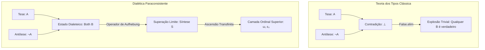

import DialecticalSpiralVisualizer from "../../../components/math/DialecticalSpiralVisualizer";

# De Cantor a Hegel: A Formalização da Dialética, Ordinais Transfinitos e Lógicas Paraconsistentes em Lean 4

Por mais de dois séculos, a dialética hegeliana — o movimento do pensamento através da contradição, negação e superação (*Aufhebung*) — foi simultaneamente reverenciada como uma intuição filosófica profunda e rejeitada como uma mistificação logicamente vazia. A barreira primária para sua formalização matemática sempre foi o **Princípio da Explosão** clássico (*Ex Falso Quodlibet*): na lógica clássica, permitir uma única contradição $\textcolor{#a855f7}{A} \wedge \neg \textcolor{#a855f7}{A}$ colapsa imediatamente o universo formal na trivialidade, provando que $0 = 1$ e obliterando todas as distinções semânticas.

No entanto, a lógica matemática moderna possui ferramentas com as quais Georg Wilhelm Friedrich Hegel só poderia sonhar. Ao cruzar a **aritmética ordinal transfinita de Cantor** com **teorias de tipos paraconsistentes** em **Lean 4**, podemos transformar a negação dialética em uma estrutura matemática analítica e mecanicamente verificável.

---

## I. O Paradoxo Dialético e o Colapso Clássico

Na teoria dos tipos intuicionista padrão (o fundamento do Lean 4, Coq e Agda), a negação é definida construtivamente como uma implicação para o tipo vazio:
$$
\neg \textcolor{#a855f7}{A} \equiv \textcolor{#a855f7}{A} \to \textcolor{#f43f5e}{\bot}
$$

Sob a correspondência de Curry-Howard, se um agente possui tanto uma prova de $\textcolor{#a855f7}{A}$ quanto uma prova de $\neg \textcolor{#a855f7}{A}$, ele pode construir um termo do tipo desabitado $\textcolor{#f43f5e}{\bot}$ (`False`). A partir de $\textcolor{#f43f5e}{\bot}$, a regra `False.elim` produz um termo de *qualquer* tipo arbitrário $\textcolor{#3b82f6}{B}$:
$$
\textcolor{#a855f7}{A} \wedge \neg \textcolor{#a855f7}{A} \vdash \textcolor{#3b82f6}{B}
$$

No Lean 4, isso é verificado como uma tautologia imediata:

```lean
-- No Lean 4 clássico/intuicionista, a contradição trivializa o sistema instantaneamente
theorem classical_explosion (A B : Prop) (h1 : A) (h2 : ¬A) : B :=
  False.elim (h2 h1)
```

Para a filosofia dialética, onde cada determinação finita contém a semente interna de sua própria negação (a Tese encontra a Antítese), essa explosão clássica é catastrófica. A dialética ingênua na teoria dos tipos padrão é fatal: ela não gera uma síntese superior; gera trivialidade imediata.

Para formalizar a dialética sem colapso, devemos substituir a negação explosiva clássica por uma estrutura analítica capaz de abrigar momentos contraditórios sem perder a estrutura informativa.

---

## II. Ordinais Cantorianos como *Aufhebung* Dialética

A crítica mais rigorosa de Hegel à matemática na *Ciência da Lógica* concentra-se na distinção entre dois infinitos:
1.  **O Infinito Espúrio (*Schlechte Unendlichkeit*):** A sequência interminável e repetitiva $+1$ dos números naturais finitos ($\textcolor{#fbbf24}{n} \to \textcolor{#fbbf24}{n}+1$). Ela nunca atinge o infinito; apenas foge do finito em uma progressão linear não mediada.
2.  **O Infinito Verdadeiro (*Wahrhafte Unendlichkeit*):** Uma totalidade afirmativa e autocontida que não se opõe ao finito, mas internaliza e supera (*aufhebt*) toda a progressão finita em uma unidade superior.

A descoberta dos ordinais transfinitos por Georg Cantor fornece a realização matemática exata dessa distinção:

### 1. Ordinais Sucessores ($\textcolor{#fbbf24}{\alpha} + 1$) como Transgressão Finita
Um ordinal sucessor é formado pela adjunção do conjunto de todos os elementos anteriores:
$$
\textcolor{#fbbf24}{\alpha} + 1 = \textcolor{#fbbf24}{\alpha} \cup \{\textcolor{#fbbf24}{\alpha}\}
$$
Isso espelha o infinito espúrio: cada sucessor está vinculado ao seu predecessor por um passo idêntico e puramente quantitativo.

### 2. Ordinais Limite ($\textcolor{#fbbf24}{\lambda}$) como Superação Qualitativa
Um ordinal limite não pode ser alcançado aplicando a operação de sucessor a nenhum predecessor. Em vez disso, ele é definido como o supremo de todos os ordinais anteriores:
$$
\textcolor{#fbbf24}{\lambda} = \bigcup_{\textcolor{#fbbf24}{\beta} < \textcolor{#fbbf24}{\lambda}} \textcolor{#fbbf24}{\beta}
$$

O primeiro ordinal limite, $\textcolor{#fbbf24}{\omega} = \{0, 1, 2, 3, \dots\}$, é a quintessência matemática da *Aufhebung*:
*   **Conserva (*conservare*):** Todo número natural finito $\textcolor{#fbbf24}{n}$ pertence a $\textcolor{#fbbf24}{\omega}$.
*   **Cancela (*tollere*):** Nenhuma das propriedades finitas (por exemplo, a própria finitude) se aplica a $\textcolor{#fbbf24}{\omega}$.
*   **Eleva (*elevare*):** $\textcolor{#fbbf24}{\omega}$ inaugura um reino qualitativo completamente novo da aritmética transfinita.

### 3. A Ideia Absoluta como Epsilon-Zero ($\textcolor{#fbbf24}{\varepsilon_0}$)
Conforme iteramos potências transfinitas ($\textcolor{#fbbf24}{\omega}, \textcolor{#fbbf24}{\omega}^{\textcolor{#fbbf24}{\omega}}, \textcolor{#fbbf24}{\omega}^{\textcolor{#fbbf24}{\omega}^{\textcolor{#fbbf24}{\omega}}}, \dots$), chegamos ao primeiro ponto fixo da exponenciação ordinal:
$$
\textcolor{#fbbf24}{\varepsilon_0} = \textcolor{#fbbf24}{\omega}^{\textcolor{#fbbf24}{\varepsilon_0}} = \sup \{\textcolor{#fbbf24}{\omega}, \textcolor{#fbbf24}{\omega}^{\textcolor{#fbbf24}{\omega}}, \textcolor{#fbbf24}{\omega}^{\textcolor{#fbbf24}{\omega}^{\textcolor{#fbbf24}{\omega}}}, \dots\}
$$
Em $\textcolor{#fbbf24}{\varepsilon_0}$, a operação de elevar $\textcolor{#fbbf24}{\omega}$ a uma potência não produz mais uma transcendência externa; ela reproduz o próprio ordinal. Esta é a estrutura topológica exata da **Ideia Absoluta** de Hegel: um fechamento auto-fundamentado e autorreferencial que contém sua própria regra generativa.

<DialecticalSpiralVisualizer />

---

## III. Taxonomia Comparativa de Modelos Paraconsistentes em Lean 4

Para modelar a tríade dialética $(\text{Tese} \to \text{Antítese} \to \text{Síntese})$ dentro do Lean 4 sem disparar o `False.elim`, avaliamos quatro estruturas formais fundamentais:

```text
+---------------------------------------------------------------------------------------+
|                                TAXONOMIA PARACONSISTENTE                              |
+------------------------------------+--------------------------------------------------+
| Estrutura de Modelagem             | Mecanismo Dialético                              |
+------------------------------------+--------------------------------------------------+
| 1. Semântica de Bilattice (FOUR)   | Valores de verdade {N, T, F, B} com ordem info   |
| 2. Negação Construtiva Forte       | Pares simétricos de testemunhas de prova/refuta  |
| 3. Feixes Modais de Kripke         | Dialética como discurso distribuído multi-mundo  |
| 4. Adjunções Categoriais           | Aufhebung como ponto fixo de operador de fecho   |
+------------------------------------+--------------------------------------------------+
```



---

### Abordagem 1: Semântica de Bilattice (Belnap-Dunn $\mathcal{FOU\textcolor{#fbbf24}{R}}$)

Na lógica de Belnap-Dunn, as proposições assumem valores em um bilattice de quatro elementos:
$$
\mathcal{FOU\textcolor{#fbbf24}{R}} = \{\mathbf{N}, \mathbf{T}, \mathbf{F}, \mathbf{B}\}
$$
Onde $\mathbf{N}$ é Nem-Verdadeiro-Nem-Falso (*Neither*), $\mathbf{T}$ é Verdadeiro (*True*), $\mathbf{F}$ é Falso (*False*) e $\mathbf{B}$ é **Ambos** (*Both* / dialeteico / contraditório).

O bilattice é equipado com duas ordens parciais independentes:
*   **Ordem da Verdade ($\le_{\textcolor{#fbbf24}{t}}$):** $\mathbf{F} \le_{\textcolor{#fbbf24}{t}} \mathbf{N}, \mathbf{B} \le_{\textcolor{#fbbf24}{t}} \mathbf{T}$
*   **Ordem da Informação/Conhecimento ($\le_k$):** $\mathbf{N} \le_k \mathbf{T}, \mathbf{F} \le_k \mathbf{B}$

Quando a Tese ($\mathbf{T}$) encontra a Antítese ($\mathbf{F}$), seu ínfimo na ordem da informação gera o estado contraditório $\mathbf{B}$:
$$
\mathbf{T} \otimes \mathbf{F} = \mathbf{B}
$$
Como $\mathbf{B}$ é um valor de verdade designado, a inferência não explode.

```lean
-- Abordagem 1: Belnap-Dunn FOUR em Lean 4
inductive Four : Type where
  | neither : Four  -- N
  | false   : Four  -- F
  | true    : Four  -- T
  | both    : Four  -- B (Dialetheia / Contradição)
deriving DecidableEq, Repr

namespace Four

-- A negação inverte T e F, mas preserva N e B
def neg : Four → Four
  | neither => neither
  | false   => true
  | true    => false
  | both    => both

-- Ínfimo na ordem da verdade (Conjunção)
def land : Four → Four → Four
  | true, b => b
  | false, _ => false
  | both, neither => false
  | both, both => both
  | both, true => both
  | both, false => false
  | neither, both => false
  | neither, neither => neither
  | neither, true => neither
  | neither, false => false

-- Operador de Aufhebung: eleva a informação contraditória para uma camada superior
def sublate (thesis antithesis : Four) : Four :=
  if thesis = true ∧ antithesis = false then both
  else land thesis (neg antithesis)

-- Prova formal de que a contradição NÃO implica explosão em FOUR
theorem four_non_explosive :
  ∃ (p q : Four), (land p (neg p) = both) ∧ (q = false) := by
  use both, false
  decide

end Four
```

---

### Abordagem 2: Lógica Construtiva com Negação Forte (Semântica de Nelson)

David Nelson formulou sistemas paraconsistentes construtivos separando a negação do tipo vazio. Em vez de definir $\neg \textcolor{#a855f7}{A} \equiv \textcolor{#a855f7}{A} \to \textcolor{#f43f5e}{\bot}$, cada proposição carrega duas testemunhas simétricas e independentes:
1.  **Testemunha de Verificação ($\textcolor{#a855f7}{A}^+$):** Evidência direta provando $\textcolor{#a855f7}{A}$.
2.  **Testemunha de Refutação ($\textcolor{#a855f7}{A}^-$):** Evidência direta refutando $\textcolor{#a855f7}{A}$.

Uma contradição ocorre quando ambas as testemunhas estão presentes simultaneamente ($\textcolor{#a855f7}{A}^+ \wedge \textcolor{#a855f7}{A}^-$). A superação (*Aufhebung*) é formalizada como um operador que empacota essa tensão em um objeto construtivo de ordem superior.

```lean
-- Abordagem 2: Pares de Evidência de Nelson em Lean 4
structure DialecticalProp where
  verified   : Prop
  refuted    : Prop

namespace DialecticalProp

def mk_thesis (P : Prop) : DialecticalProp :=
  ⟨P, False⟩

def mk_antithesis (P : Prop) : DialecticalProp :=
  ⟨False, P⟩

-- A conjunção preserva evidências positivas e negativas de forma independente
def conj (p q : DialecticalProp) : DialecticalProp :=
  ⟨p.verified ∧ q.verified, p.refuted ∨ q.refuted⟩

-- Negação forte troca as evidências de prova e refutação
def strong_neg (p : DialecticalProp) : DialecticalProp :=
  ⟨p.refuted, p.verified⟩

-- Aufhebung dialética: cria um estado composto a partir da contradição
def aufhebung (p : DialecticalProp) (h_contra : p.verified ∧ p.refuted) : DialecticalProp :=
  ⟨p.verified ∧ p.refuted, False⟩

-- A contradição não explode: False não é derivado
theorem nelson_avoids_explosion (p : DialecticalProp) (h : p.verified ∧ (strong_neg p).verified) :
  p.verified ∧ p.refuted := by
  exact h

end DialecticalProp
```

---

### Abordagem 3: Feixes Modais e Discursivos (Mundos de Jaśkowski)

Stanisław Jaśkowski inventou a **Lógica Discursiva** ($\mathbf{D_2}$) definindo a verdade como relativa a uma comunidade de discurso ou mundos epistêmicos modais.

Em uma estrutura de Kripke $(W, \textcolor{#fbbf24}{R})$, uma proposição $\textcolor{#a855f7}{A}$ é afirmada dialeticamente se ela é possível ($\Diamond \textcolor{#a855f7}{A}$), significando que existe um mundo onde ela se sustenta. Dois participantes podem afirmar $\textcolor{#a855f7}{A}$ e $\neg \textcolor{#a855f7}{A}$ sem colapso, porque:
$$
\Diamond \textcolor{#a855f7}{A} \wedge \Diamond \neg \textcolor{#a855f7}{A} \not\vdash \textcolor{#f43f5e}{\bot}
$$

A Tese se sustenta no mundo histórico $\textcolor{#fbbf24}{w_1}$, a Antítese emerge no mundo reativo $\textcolor{#fbbf24}{w_2}$, e a Síntese é um mundo limite $\textcolor{#fbbf24}{w}_{\textcolor{#fbbf24}{\omega}}$ acessível a partir de ambos.

```lean
-- Abordagem 3: Dialética Indexada por Mundos Modais em Lean 4
structure KripkeWorld where
  id : Nat

def ModalProp (World : Type) := World → Prop

namespace ModalProp

variable {World : Type}

def box (R : World → World → Prop) (p : ModalProp World) : ModalProp World :=
  fun w => ∀ w', R w w' → p w'

def diamond (R : World → World → Prop) (p : ModalProp World) : ModalProp World :=
  fun w => ∃ w', R w w' ∧ p w'

-- Coexistência de Tese e Antítese sem contradição local
theorem modal_coexistence (R : World → World → Prop) (p : ModalProp World) (w : World)
  (h1 : ∃ w1, R w w1 ∧ p w1)
  (h2 : ∃ w2, R w w2 ∧ ¬ p w2) :
  diamond R p w ∧ diamond R (fun w' => ¬ p w') w := by
  exact ⟨h1, h2⟩

end ModalProp
```

---

### Abordagem 4: Adjunções Categoriais e Operadores de Ponto Fixo (Lawvere)

William Lawvere reconheceu que as tríades dialéticas de Hegel correspondem diretamente a **Funtores Adjuntos** na Teoria das Categorias. Especificamente, a relação entre Ser, Nada e Devir mapeia para a tríade adjunta canônica:
$$
\exists_f \dashv f^* \dashv \forall_f
$$

A superação (*Aufhebung*) é formalizada como uma **Mônada** (operador de fecho) $\textcolor{#a855f7}{T}: \mathcal{\textcolor{#10b981}{C}} \to \mathcal{\textcolor{#10b981}{C}}$ equipada com uma condição de ponto fixo:
$$
\textcolor{#a855f7}{T}(X) \cong X
$$

```lean
-- Abordagem 4: Operadores de Fecho Dialético em Lean 4
class ClosureOperator (α : Type) [PartialOrder α] where
  cl : α → α
  extensive : ∀ x, x ≤ cl x
  monotone  : ∀ x y, x ≤ y → cl x ≤ cl y
  idempotent: ∀ x, cl (cl x) = cl x

-- A Aufhebung de um elemento x é seu fecho sob o operador dialético
def aufhebung_closure {α : Type} [PartialOrder α] [ClosureOperator α] (x : α) : α :=
  ClosureOperator.cl x

-- Pontos fixos do operador de fecho representam superações completamente estabilizadas
def is_sublated_fixed_point {α : Type} [PartialOrder α] [ClosureOperator α] (x : α) : Prop :=
  ClosureOperator.cl x = x
```

---

## IV. Matriz de Avaliação Comparativa

| Estrutura | Implementação em Lean 4 | Tratamento da Explosão | Fidelidade Dialética | Complexidade Matemática |
|---|---|---|---|---|
| **Clássica (ZFC / Coq)** | `Prop` Nativa | **Falha (Explosão)** | Zero (Colapso trivial) | Baixa |
| **Belnap-Dunn ($\mathcal{FOU\textcolor{#fbbf24}{R}}$)** | Indutivo Customizado `Four` | **Contida (Valor $\mathbf{B}$)** | Alta (Dialeteia Estática) | Baixa |
| **Negação Forte de Nelson** | Par Construtivo `(A⁺, A⁻)` | **Contida (Testemunhas)** | Alta (Tensão Construtiva) | Média |
| **Lógica Modal Discursiva** | Feixes `World → Prop` | **Contida ($\Diamond \textcolor{#a855f7}{A} \wedge \Diamond \neg \textcolor{#a855f7}{A}$)** | Média (Relacional) | Média |
| **Adjunções Categoriais** | Fecho de Poset / Mônadas | **Estrutural (Ordem Poset)** | Extrema (*Aufhebung* Formal) | Alta |

---

## V. Rumo a uma Teoria dos Tipos Dialética Mecanizada

A formalização de Hegel através de Cantor revela que **a dialética não é a inimiga da lógica formal; ela é o seu limite transfinito**.

Quando delimitadas pela contenção paraconsistente, as contradições deixam de ser erros terminais e tornam-se catalisadores computacionais ativos. A ascensão através das hierarquias ordinais $(\textcolor{#fbbf24}{\omega}, \textcolor{#fbbf24}{\omega}^{\textcolor{#fbbf24}{\omega}}, \textcolor{#fbbf24}{\varepsilon_0})$ fornece o arcabouço exato necessário para modelar sistemas cognitivos auto-aprimoráveis, síntese automatizada de provas e metaética formal.

Ao traduzirmos a filosofia especulativa em código Lean 4 rigorosamente verificado, unimos as intuições mais profundas da filosofia continental com a blindagem inabalável da matemática construtiva.
