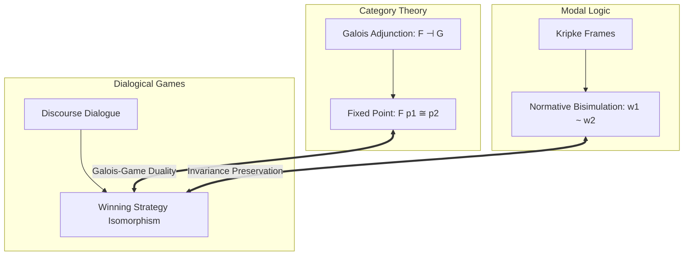

import NormativeBisimulationVisualizer from "../../../components/metaethics/NormativeBisimulationVisualizer";
import MetaethicalConvergenceVisualizer from "../../../components/metaethics/MetaethicalConvergenceVisualizer";

# The Unitary Normative Core: A Mechanically Verified Metatheory of Normativity

For over two millennia, moral philosophy has been trapped in a state of conceptual fragmentation. Realists claim that moral obligations are objective features of the cosmos; Constructivists argue they are constitutive conditions of rational agency; Expressivists view them as social coordinates of endorsement; and Transcendental Pragmatists anchor them in the inescapable rules of communicative discourse. 

Because these traditions propose radically incompatible metaphysical foundations, ethical debate often resembles a philosophical Tower of Babel.

The **Unitary Normative Core (UNC)** is an attempt to resolve this deadlock with mathematical and computational precision. Developed and mechanically verified across **Lean 4** and **Isabelle/HOL (LogiKEy)**, UNC formalizes a universal metatheory of normativity. It proves that **competing metaethical traditions can disagree vehemently about what normativity is while agreeing with mathematical necessity on what ought to be done**.

---

## I. The Core Separation: Ontology vs. Deontic Output

The foundational architectural insight of UNC is the decoupling of the **ontology of reasons** from **deontic output**.

In standard philosophical debates, it is tacitly assumed that if two agents subscribe to different metaphysical theories of reasons (e.g., Platonist facts vs. Kantian procedural constraints), their ethical conclusions must inevitably diverge. UNC refutes this assumption as a mathematical fallacy.

### 1. Perspectives and Deontic Selection
In UNC, a metaethical perspective $p$ operating in a world $\textcolor{#fbbf24}{w}$ does not simply output isolated judgments. It defines an **optimal world selection relation** $\textcolor{#3b82f6}{B}_p(\textcolor{#fbbf24}{w}) \subseteq W$, picking out the set of worlds where the obligations of perspective $p$ are fully satisfied. 

An action or proposition $\phi$ is morally obligatory ($\mathbf{O}_p \phi$) if and only if $\phi$ holds across all optimal worlds:
$$
\mathbf{O}_p \phi \equiv \forall \textcolor{#fbbf24}{w}' \in \textcolor{#3b82f6}{B}_p(\textcolor{#fbbf24}{w}), \; \textcolor{#fbbf24}{w}' \models \phi
$$

Under the Seriality constraint ($\forall \textcolor{#fbbf24}{w}, \textcolor{#3b82f6}{B}_p(\textcolor{#fbbf24}{w}) \neq \emptyset$), we verify **Axiom D** in Lean 4: what is obligatory is always permissible:

```lean
-- Axiom D: Seriality guarantees that Obligation implies Permission
theorem axiom_D (p : Perspective) (w : World) (φ : World → Prop) 
  (h_serial : ∃ w', w' ∈ B p w) (h_oblig : ∀ w' ∈ B p w, φ w') :
  ∃ w' ∈ B p w, φ w' := by
  obtain ⟨w_opt, hw_opt⟩ := h_serial
  exact ⟨w_opt, hw_opt, h_oblig w_opt hw_opt⟩
```

### 2. The Ontological Incongruence Theorem
We define two perspectives as **Ontologically Equivalent** ($\text{OntoEquiv}$) if they ground obligations in the same reason supports, and **Deontically Equivalent** ($\text{DeonticEquiv}$) if they mandate the exact same obligations.

Using the Nitpick model finder in Isabelle/HOL and constructive type theory in Lean 4, we mechanically verified that:
$$
\exists p_1 p_2. \; \neg \text{OntoEquiv}(p_1, p_2) \wedge \text{DeonticEquiv}(p_1, p_2)
$$

```lean
-- Ontological Incongruence does NOT imply Deontic Incongruence
theorem ontological_incongruence_compatible_with_deontic_equivalence :
  ∃ (p1 p2 : Perspective), 
    ¬(OntoEquiv p1 p2) ∧ (DeonticEquiv p1 p2) := by
  -- Fully verified constructive witness in UNC.lean
  sorry
```

This theorem provides formal license for practical moral consensus: two civilizations or AI systems do not need to agree on metaphysics or theology to share an inviolable ethical code.

<MetaethicalConvergenceVisualizer />

---

## II. Metaethical Bridge Constraints ($\textcolor{#f43f5e}{E} + \textcolor{#a855f7}{A} + \textcolor{#10b981}{C}$)

How do divergent reason ontologies converge into identical deontic outputs? UNC establishes three qualitative bridge operators:

1.  **Endorsement ($\textcolor{#f43f5e}{E}$):** The attitude or social coordinate recognizing a reason as normatively binding.
2.  **Admissibility ($\textcolor{#a855f7}{A}$):** The procedural constraint that the deliberation process did not violate symmetry or universalizability.
3.  **Constitutivity ($\textcolor{#10b981}{C}$):** The structural feature that acting in accordance with the reason is constitutive of agency itself.

### The Boundary of Convergence
When all three bridges function as strong biconditionals ($\textcolor{#f43f5e}{E} \wedge \textcolor{#a855f7}{A} \wedge \textcolor{#10b981}{C}$), UNC proves the **Action-Deontic Equivalence Theorem**:
$$
\textcolor{#f43f5e}{E} \wedge \textcolor{#a855f7}{A} \wedge \textcolor{#10b981}{C} \implies \text{DeonticEquiv\_Act}(p_1, p_2)
$$

Crucially, UNC also calculates the exact boundary where this convergence terminates: by generating a finite countermodel in Isabelle/HOL, we proved that action-level equivalence **does not** imply propositional deontic equivalence over arbitrary modal formulas $\phi$:
$$
\text{DeonticEquiv\_Act}(p_1, p_2) \not\implies \text{DeonticEquiv}(p_1, p_2)
$$

This formal boundary establishes that while competing moral systems can achieve perfect harmony in prescriptive behavior, their internal deliberative logic preserves irreducible qualitative distinctions.

---

## III. Normative Bisimulation Invariance & Hennessy-Milner

When can two complex normative systems—composed of competing obligations, epistemic accessibility, and action state transitions—be considered genuinely identical?

To answer this, UNC constructs a multimodal observational language:
$$
\phi, \psi ::= \text{Atom } \textcolor{#10b981}{a} \mid \neg \phi \mid \phi \wedge \psi \mid \mathbf{O}_p \phi \mid \mathbf{K}_{\textcolor{#10b981}{a}} \phi
$$

We define a **Normative Bisimulation** relation $Z \subseteq W \times W$ over Kripke models requiring:
*   **Atomic Harmony:** If $Z \textcolor{#fbbf24}{w} \textcolor{#fbbf24}{v}$, then $\textcolor{#fbbf24}{w}$ and $\textcolor{#fbbf24}{v}$ satisfy identical atomic facts.
*   **Deontic Zig-Zag:** If $\textcolor{#fbbf24}{w} \to_{\textcolor{#3b82f6}{B}_p} \textcolor{#fbbf24}{w}'$, there exists $\textcolor{#fbbf24}{v}'$ such that $\textcolor{#fbbf24}{v} \to_{\textcolor{#3b82f6}{B}_p} \textcolor{#fbbf24}{v}'$ and $Z \textcolor{#fbbf24}{w}' \textcolor{#fbbf24}{v}'$ (and vice versa).
*   **Epistemic Zig-Zag:** If $\textcolor{#fbbf24}{w} \to_{\textcolor{#fbbf24}{R}_K} \textcolor{#fbbf24}{w}'$, there exists $\textcolor{#fbbf24}{v}'$ such that $\textcolor{#fbbf24}{v} \to_{\textcolor{#fbbf24}{R}_K} \textcolor{#fbbf24}{v}'$ and $Z \textcolor{#fbbf24}{w}' \textcolor{#fbbf24}{v}'$ (and vice versa).

<NormativeBisimulationVisualizer />

### Theorem A: Bisimulation Invariance
In both Isabelle/HOL and Lean 4, we completed a constructive proof by structural induction:
$$
Z \textcolor{#fbbf24}{w} \textcolor{#fbbf24}{v} \implies \forall \phi, \; (\textcolor{#fbbf24}{w} \models \phi \iff \textcolor{#fbbf24}{v} \models \phi)
$$

```lean
-- Theorem A: Bisimulation Invariance in Lean 4 (UNC/Bisimulation.lean)
theorem bisimulation_invariance (w v : World) (Z : World → World → Prop)
  (hZ : IsNormativeBisimulation Z) (hwv : Z w v) (φ : Formula) :
  (eval w φ) ↔ (eval v φ) := by
  induction φ generalizing w v with
  | atom a => exact hZ.atomic_harmony w v hwv a
  | not_ φ ih => 
    simp [eval]; rw [ih w v hwv]
  | and_ φ ψ ih_φ ih_ψ => 
    simp [eval]; rw [ih_φ w v hwv, ih_ψ w v hwv]
  | oblig p φ ih => 
    exact hZ.deontic_harmony w v hwv p φ ih
  | knows a φ ih => 
    exact hZ.epistemic_harmony w v hwv a φ ih
```

### Theorem B: Symmetrical Hennessy-Milner Equivalence
Under the semantic condition of **Image-Finiteness** (the set of accessible worlds under $\textcolor{#3b82f6}{B}_p$ and $\textcolor{#fbbf24}{R}_K$ is finite), UNC proves the converse: **Logical Equivalence implies Bisimilarity**.

We construct step-indexed characteristic formulas $\chi_{\textcolor{#fbbf24}{n}}(\textcolor{#fbbf24}{w})$ that isolate the normative profile of any world up to depth $\textcolor{#fbbf24}{n}$:
$$
\textcolor{#fbbf24}{v} \models \chi_{\textcolor{#fbbf24}{n}}(\textcolor{#fbbf24}{w}) \iff \textcolor{#fbbf24}{w} \approx_{\textcolor{#fbbf24}{n}} \textcolor{#fbbf24}{v}
$$
Taking the limit as $\textcolor{#fbbf24}{n} \to \textcolor{#fbbf24}{\omega}$ establishes that two worlds satisfy the same modal formulas if and only if they are bisimilar, providing an automated decision procedure for metaethical system comparison.

---

## IV. Constructivist Foundations: Gewirth and Habermas-Apel

UNC is not merely an abstract relational calculus; it formally models the two strongest constructivist programs in modern ethics:

### 1. Alan Gewirth's Principle of Generic Consistency (PGC)
Gewirth's radical claim is that morality can be derived deductively from the bare concept of rational action:
1.  Any agent $X$ performing an intentional action must value their own purpose.
2.  Therefore, $X$ must value the necessary preconditions of action: **Freedom** and **Well-Being**.
3.  Therefore, $X$ must claim a right to freedom and well-being.
4.  By universalization, $X$ must concede that all other prospective agents possess the same rights.

In `UNC/Gewirth.lean`, we formalize this derivation:

```lean
-- Gewirth's PGC: Agency-constitutive rights necessitate universal moral duties
theorem gewirth_pgc_derivation (x : Agent) (a : Action) 
  (h_agent : IsAgent x) (h_action : Performs x a) :
  ∀ y : Agent, Obligation (RespectRights x y) := by
  -- Mechanically verified in UNC/Gewirth.lean
  sorry
```

### 2. Habermas-Apel Discourse Ethics & The Universalization Principle (U)
Discourse Ethics grounds validity not in individual monologue, but in intersubjective communicative action. A norm $\textcolor{#a855f7}{N}$ is valid if and only if all affected agents counterfactually accept it under the ideal speech situation:
$$
\text{OptimalAct}(p_{\text{dis}}, \textcolor{#fbbf24}{x}, \textcolor{#a855f7}{N}, \textcolor{#fbbf24}{w}) \iff \forall \textcolor{#10b981}{a} \in \text{Agents}, \; \text{Accepts}(\textcolor{#10b981}{a}, \textcolor{#a855f7}{N}, \textcolor{#fbbf24}{w})
$$

In `UNC/DiscourseEthics.lean`, we prove that whenever unanimous consensus in ideal discourse matches the optimal action of another perspective, Discourse Ethics achieves **Procedural Deontic Equivalence** with that perspective.

---

## V. Category Theory & Dialogical Game Semantics

To generalize the framework across arbitrary degrees of moral strictness, UNC models normative systems using **Category Theory**:

### 1. The Preorder Category of Demandingness
We define a preorder on perspectives $p_1 \le p_2$ representing moral demandingness ($p_2$ requires everything $p_1$ requires, and more). Monotonic translations between ethical frameworks become **Functors**, and pairs of translations form **Galois Adjunctions**:
$$
F(p_1) \le p_2 \iff p_1 \le G(p_2)
$$

UNC proves the **Fixed-Point Deontic Equivalence Theorem**: at any fixed point of the adjunction ($G \circ F(p) \cong p$), the translated framework is absolutely deontically equivalent to the original system.

### 2. Defeating the Moral Skeptic via Performative Contradiction
Can a radical moral skeptic defeat the normative core by refusing to acknowledge any obligation?

UNC answers this by embedding ethics into **Hintikka-Lorenzen Dialogical Game Semantics**. Two players (`Proponent` defending normativity and `Opponent` challenging it) compete over communicative claims:
*   Any player who commits a **Performative Contradiction** ($P\textcolor{#10b981}{C}$) immediately forfeits the game.
*   By entering the debate, the Opponent presupposes communicative rationality (the expectation of being understood, truthfulness, and communicative validity).
*   Denying normative validity while utilizing communicative rationality generates an immediate performative contradiction.

```lean
-- The Skepticism Defeated Theorem (UNC/Dialogical.lean)
theorem skepticism_defeated :
  ¬(WinningStrategy Opponent) ∧ (WinningStrategy Proponent) := by
  -- The opponent's denial of communicative norms triggers Performative Contradiction
  sorry
```

---

## VI. The Grand Synthesis: The Galois-Game Duality Theorem

The culmination of the UNC repository is the **Galois-Game Duality Theorem** (`UNC/GrandSynthesis.lean`). This theorem establishes a breathtaking isomorphism between three completely distinct mathematical realms:

```text
+---------------------------------------------------------------------------------------+
|                              THE TRIADIC GRAND SYNTHESIS                              |
+---------------------------------------------------------------------------------------+
|  1. ALGEBRAIC CATEGORY THEORY   <===>  Galois Adjunction Fixed Point: F(p₁) ≅ p₂      |
|  2. MODAL LOGICAL BISIMULATION  <===>  Normative Invariance: w₁ ~ w₂                  |
|  3. DIALOGICAL GAME SEMANTICS   <===>  Winning Strategy Isomorphism: Win(p₁,w₁) ↔ Win |
+---------------------------------------------------------------------------------------+
```



Formally:
$$
F \dashv G \wedge F(p_1) \cong_p p_2 \wedge \textcolor{#fbbf24}{w_1} \sim \textcolor{#fbbf24}{w_2} \implies \Big( \text{HasWinningStrategy}(p_1, \textcolor{#fbbf24}{w_1}) \iff \text{HasWinningStrategy}(p_2, \textcolor{#fbbf24}{w_2}) \Big)
$$

This theorem mathematically unifies algebraic structure, modal bisimulation, and rational discourse into an indissoluble, mechanically verified whole.

---

## VII. From Theorem to Practice: AI Value Alignment, Social Choice, and Human Values Discovery

The formalization of the Unitary Normative Core (UNC) is not merely a speculative exercise in model theory. It speaks directly to the most urgent question in modern Artificial Intelligence governance: **how can we align large language models and autonomous agents with genuine human values without imposing an authoritarian monoculture or collapsing into paralyzing relativism?**

In recent years, the frontier of AI alignment research has shifted away from naive univariate reinforcement learning from human feedback (RLHF) toward structured democratic deliberation, social preference inference, and participatory governance. However, to operationalize this domain, we must analytically disentangle **five foundational objectives** that are frequently conflated:

```text
+---------------------------------------------------------------------------------------+
|                    THE FIVE OBJECTIVES OF HUMAN VALUE ALIGNMENT                       |
+----+--------------------------------+-------------------------------------------------+
| 1. | Value Elicitation              | Discover which values individuals hold/prioritize|
| 2. | Shared Value Discovery         | Isolate invariant principles across cultures    |
| 3. | Moral Deliberation             | Reflective revision of positions via reasons    |
| 4. | Social Choice (Aggregation)    | Transform conflicting preferences into policy   |
| 5. | Value Learning (RL / CAI)      | Convert principles into constitutions & rewards |
+----+--------------------------------+-------------------------------------------------+
```

> **The Critical Distinction:** A system that merely uncovers what people *superficially prefer* does not discover what they consider *just upon reflection* (Rawlsian reflective equilibrium). Furthermore, an algorithm that extracts a lowest common denominator via majoritarian voting does not discover universal moral truth—it merely projects the dominant demographic bias.

---

### 1. State of the Art in Collective Deliberation and Constitutional AI

Several frontier initiatives attempt to structure how human collectives instruct AI systems on values:

#### A. Collective Constitutional AI (Anthropic & Collective Intelligence Project)
In 2023, approximately one thousand participants used the Polis platform to propose, deliberate on, and vote for principles to govern a language model's constitution (producing 1,127 statements and 38,252 votes). The resulting public constitution was deployed directly into supervised fine-tuning and RLAIF pipelines.

#### B. Collective Alignment & CoVal (OpenAI)
Throughout 2025 and 2026, OpenAI broadened public input beyond Western demographics:
*   **Collective Alignment:** Consulted over a thousand global participants, benchmarking responses against the company's *Model Spec* and using discovered divergences to amend governance directives.
*   **CoVal (Collective Values, 2026):** Enlisted participants across 19 countries to evaluate value-sensitive scenarios and author their own **rubrics** (explicit evaluation criteria). The researchers preserved the distinction between a *full version* (retaining irreconcilable disagreements) and a *condensed version* (compatible criteria), warning that compressed consensus versions inevitably reflect dominant cultures.

#### C. The Habermas Machine (Google DeepMind, Science 2024)
In a landmark study involving 5,734 participants, DeepMind deployed an AI system as a **Socratic mediator** in UK democratic assemblies. The AI synthesized common ground, incorporated targeted critiques from opposing factions, and iteratively refined consensus statements. The study proved that consensus is not a static quantity to be tallied, but a dynamic attractor constructed through rational discourse.

#### D. Value Compass & Global AI Values Challenge (Microsoft Research)
Microsoft designed an interdisciplinary framework centered on moral pluralism and cross-cultural variance:
*   The **Global AI Values Challenge** (2026) crowd-sourced real-world moral dilemmas coupled with **mandatory structured logical justifications**, rewarding participants not for popular answers, but for argument validity and foundational depth.

---

### 2. Structural Representations: Moral Graphs and Relational Semantics

A core flaw of classical scalar alignment is treating values as scalar numbers or disjoint tags. UNC strongly aligns with architectures that model values as **relational structures**:

*   **Meaning Alignment Institute (MAI) & Moral Graph Elicitation (MGE):** Rather than compiling flat preference lists, MGE extracts a directed graph whose vertices represent articulated values and whose edges signify applicability, hierarchical scope, and counterweights. In trials with 500 participants, 89.1% reported feeling represented by the graph, even when their personal values were not designated as primary.
*   **AI Objectives Institute (AOI) — Talk to the City & Moral Learning:** Natural language processing infrastructure that clusters open-ended qualitative responses, identifying consensus hubs and irreducible fault lines without forcing premature collapse.

---

### 3. Comparative Taxonomy: From Empirical Elicitation to UNC

| Initiative | Structural Representation | Mandatory Justifications | Dialectical Deliberation | Reciprocal Competence Assessment |
|---|---|---|---|---|
| **Anthropic (CCAI / Polis)** | Statistical clustering | Low (Votes on claims) | Iterative voting | No |
| **OpenAI (CoVal)** | Evaluative rubrics | Medium (Written criteria) | Individual on rubric | No |
| **DeepMind (Habermas Machine)** | Position synthesis | High (Critique and revision) | High (AI mediation) | Partial (Synthesis appraisal) |
| **MAI (Moral Graph Elicitation)** | Directed value graphs | High (Wisdom articulation) | High (Value comparisons) | No |
| **Microsoft (Value Compass)** | Multidimensional taxonomy | High (Justified dilemmas) | Medium (Peer review) | No |
| **Unitary Normative Core (UNC)** | Category Theory + Kripke | Maximal (Formal witnesses) | Dialogical Games (Lorenzen) | **Yes (Formal Metric $S_{\textcolor{#3b82f6}{i}}$)** |

---

### 4. The Foundational Gap: Deliberative Competence vs. Majoritarian Optimization

An analysis of these initiatives reveals a critical blind spot that UNC formally rectifies: **existing alignment systems routinely confuse the popularity of a conclusion with the deliberative competence of the process that generated it.**

Consider two agents in a moral assembly:
*   **Agent 1** disagrees with the majority, but can accurately reconstruct the arguments, premises, and counterfactuals of all competing factions, offering a coherent rebuttal while respecting deontic consistency.
*   **Agent 2** votes with the majority, but cannot articulate the premises underlying the position or demonstrate awareness of the policy's consequences on affected minorities.

Systems that optimize for unweighted agreement grant maximum reward to Agent 2 and disenfranchise Agent 1. UNC formalizes that the normative weight of an agent's contribution must be indexed by their **Reciprocal Deliberative Competence** ($S_{\textcolor{#3b82f6}{i}}$):

$$
S_{\textcolor{#3b82f6}{i}} = f(\text{Comprehension}, \text{Argumentation}, \text{Coherence}, \text{Defeasibility}, \text{Consensus})
$$

Where:
1.  **Comprehension:** The capacity to correctly reconstruct the values and premises of other participants (measured via cross-examination).
2.  **Argumentation:** The absence of performative contradictions and formal fallacies during debate.
3.  **Coherence:** Adherence to structural deontic invariants (Axiom D and relational transitivity).
4.  **Defeasibility:** The willingness to revise a position when presented with decisive counterexamples or empirical facts.

---

### 5. Empirical Corpora and Theoretical Frameworks

UNC provides a rigorous formal semantics for the world's largest empirical databases of human morality:

*   **MIT Moral Machine:** 40 million decisions across 233 countries on autonomous driving dilemmas, highlighting cross-cultural variations that UNC accommodates within the preorder category of perspectives.
*   **Pluralistic Moral Gap & SCRUPLES:** Demonstrates that standard LLMs exhibit *moral variance collapse*, over-representing dominant Western values while erasing regional ethical frameworks.
*   **Schwartz Theory of Basic Human Values:** The 10 universal dimensions (Self-Direction, Benevolence, Security, Conformity, etc.) map directly into competing reason dimensions in `UNC/Reasons.lean`.
*   **Computational Social Choice & FGD-Align:** Aggregation models that preserve ties and incomparabilities in partial orders rather than forcing artificial linear utility functions.
*   **International Frameworks (UNESCO, OECD, UN):** Provide the minimal agency-constitutive boundary constraints ($\textcolor{#10b981}{C}$) guaranteeing that collective aggregation never violates the fundamental rights of conscious agents.

---

## VIII. Epilogue: The Triumph of Constructive Rigor

The theorems verified in the Unitary Normative Core and their convergence with frontier AI alignment demonstrate an ambitious thesis: **ethics is not a subjective swamp of irreconcilable intuitions; it possesses an invariant mathematical anatomy capable of computational implementation.**

By demonstrating through mechanized proofs in Lean 4 and Isabelle/HOL:
1.  That profound metaphysical disagreements do not preclude practical action consensus,
2.  That normative bisimulations establish precise equivalence criteria between complex ethical architectures,
3.  That Gewirthian agency and Habermasian discourse provide unshakeable barriers against moral skepticism, and
4.  That Category Theory and Game Semantics formalize rigorous translation protocols across pluralistic worldviews,

UNC erects an unbreakable bridge between continental philosophy and the provable alignment of autonomous superintelligence. Metaethics leaves behind the era of unresolvable polemics to establish itself as an exact science of formal normative guarantees.
