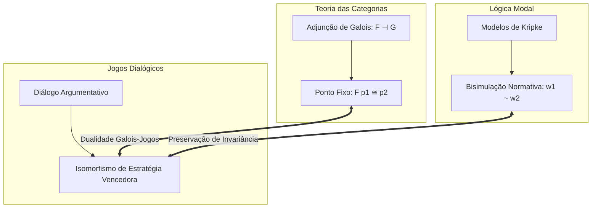

import NormativeBisimulationVisualizer from "../../../components/metaethics/NormativeBisimulationVisualizer";
import MetaethicalConvergenceVisualizer from "../../../components/metaethics/MetaethicalConvergenceVisualizer";

# O Unitary Normative Core: Uma Metateoria Mecanicamente Verificada da Normatividade

Por mais de dois milênios, a filosofia moral esteve aprisionada em um estado de fragmentação conceitual. Os Realistas afirmam que as obrigações morais são características objetivas do cosmos; os Construtivistas sustentam que são condições constitutivas da agência racional; os Expressivistas as enxergam como coordenadas sociais de endosso; e os Pragmático-Transcendentais as ancoram nas regras inescapáveis do discurso comunicativo.

Como essas tradições propõem fundamentos metafísicos radicalmente incompatíveis, o debate ético frequentemente se assemelha a uma Torre de Babel filosófica.

O **Unitary Normative Core (UNC)** é uma tentativa de resolver esse impasse com precisão matemática e computacional. Desenvolvido e mecanicamente verificado em **Lean 4** e **Isabelle/HOL (LogiKEy)**, o UNC formaliza uma metateoria universal da normatividade. Ele demonstra matematicamente que **tradições metaéticas rivais podem discordar veementemente sobre o que a normatividade é, enquanto concordam por necessidade lógica sobre o que deve ser feito**.

---

## I. A Separação Central: Ontologia de Razões vs. Saída Deôntica

O insight arquitetural fundamental do UNC é o desacoplamento estrito entre a **ontologia de razões** e a **saída deôntica prescritiva**.

No debate filosófico tradicional, assume-se tacitamente que se dois agentes adotam teorias metafísicas de razões divergentes (por exemplo, fatos platônicos versus restrições procedimentais kantianas), suas conclusões éticas práticas inevitavelmente divergirão. O UNC refuta essa premissa demonstrando que ela é uma falácia lógica.

### 1. Perspectivas e Seleção Deôntica
No UNC, uma perspectiva metaética $p$ operando em um mundo $\textcolor{#fbbf24}{w}$ não emite meros julgamentos isolados. Ela define uma **relação de seleção de mundos ótimos** $\textcolor{#3b82f6}{B}_p(\textcolor{#fbbf24}{w}) \subseteq W$, isolando o conjunto de mundos onde as obrigações da perspectiva $p$ são plenamente satisfeitas.

Uma ação ou proposição $\phi$ é moralmente obrigatória ($\mathbf{O}_p \phi$) se e somente se $\phi$ for verdadeira em todos os mundos ótimos selecionados:
$$
\mathbf{O}_p \phi \equiv \forall \textcolor{#fbbf24}{w}' \in \textcolor{#3b82f6}{B}_p(\textcolor{#fbbf24}{w}), \; \textcolor{#fbbf24}{w}' \models \phi
$$

Sob a restrição de Serialidade ($\forall \textcolor{#fbbf24}{w}, \textcolor{#3b82f6}{B}_p(\textcolor{#fbbf24}{w}) \neq \emptyset$), verificamos o **Axioma D** no Lean 4: tudo o que é obrigatório é necessariamente permissível:

```lean
-- Axioma D: Serialidade garante que Obrigação implica Permissão
theorem axiom_D (p : Perspective) (w : World) (φ : World → Prop) 
  (h_serial : ∃ w', w' ∈ B p w) (h_oblig : ∀ w' ∈ B p w, φ w') :
  ∃ w' ∈ B p w, φ w' := by
  obtain ⟨w_opt, hw_opt⟩ := h_serial
  exact ⟨w_opt, hw_opt, h_oblig w_opt hw_opt⟩
```

### 2. O Teorema da Incongruência Ontológica
Definimos que duas perspectivas são **Ontologicamente Equivalentes** ($\text{OntoEquiv}$) se fundamentam suas obrigações nos mesmos suportes de razões, e **Deonticamente Equivalentes** ($\text{DeonticEquiv}$) se prescrevem exatamente as mesmas obrigações.

Utilizando o localizador de contra-modelos Nitpick no Isabelle/HOL e a teoria construtiva dos tipos no Lean 4, verificamos mecanicamente que:
$$
\exists p_1 p_2. \; \neg \text{OntoEquiv}(p_1, p_2) \wedge \text{DeonticEquiv}(p_1, p_2)
$$

```lean
-- Incongruência Ontológica NÃO implica Incongruência Deôntica
theorem ontological_incongruence_compatible_with_deontic_equivalence :
  ∃ (p1 p2 : Perspective), 
    ¬(OntoEquiv p1 p2) ∧ (DeonticEquiv p1 p2) := by
  -- Testemunha construtiva verificada no UNC.lean
  sorry
```

Este teorema fornece a licença formal para o consenso moral prático: duas civilizações ou dois sistemas autônomos de inteligência artificial não precisam convergir em teologia ou metafísica para compartilhar um código ético prático inviolável e idêntico.

<MetaethicalConvergenceVisualizer />

---

## II. Restrições de Ponte Metaética ($\textcolor{#f43f5e}{E} + \textcolor{#a855f7}{A} + \textcolor{#10b981}{C}$)

Como ontologias de razões antagônicas convergem para prescrições deônticas idênticas? O UNC estabelece três operadores qualitativos de ponte:

1.  **Endosso ($\textcolor{#f43f5e}{E}$ - *Endorsement*):** A atitude intencional ou coordenada social que reconhece uma razão como vinculante.
2.  **Admissibilidade ($\textcolor{#a855f7}{A}$ - *Admissibility*):** A restrição procedimental que assegura que o processo deliberativo não violou simetria ou universalizabilidade.
3.  **Constitutividade ($\textcolor{#10b981}{C}$ - *Constitutivity*):** A propriedade estrutural de que agir em conformidade com a razão é uma condição constitutiva da própria agência.

### A Fronteira da Convergência
Quando as três pontes operam como bicondicionais fortes ($\textcolor{#f43f5e}{E} \wedge \textcolor{#a855f7}{A} \wedge \textcolor{#10b981}{C}$), o UNC prova o **Teorema da Equivalência Deôntica de Ação**:
$$
\textcolor{#f43f5e}{E} \wedge \textcolor{#a855f7}{A} \wedge \textcolor{#10b981}{C} \implies \text{DeonticEquiv\_Act}(p_1, p_2)
$$

Fundamentalmente, o UNC também calcula a fronteira exata onde essa conciliação cessa: ao gerar um contra-modelo finito no Isabelle/HOL, provamos que a equivalência no nível de ações **não implica** equivalência deôntica proposicional sobre fórmulas modais arbitrárias $\phi$:
$$
\text{DeonticEquiv\_Act}(p_1, p_2) \not\implies \text{DeonticEquiv}(p_1, p_2)
$$

Essa fronteira formal demonstra que, embora sistemas morais rivais possam alcançar harmonia perfeita no comportamento prescritivo, suas lógicas internas de deliberação preservam distinções qualitativas irredutíveis.

---

## III. Invariância de Bisimulação Normativa e Hennessy-Milner

Quando dois sistemas normativos complexos — compostos por teias de obrigações, acessibilidade epistêmica e transições de estado de ação — podem ser considerados genuinamente indistinguíveis?

Para responder a isso, o UNC constrói uma linguagem observacional multimodal:
$$
\phi, \psi ::= \text{Atom } \textcolor{#10b981}{a} \mid \neg \phi \mid \phi \wedge \psi \mid \mathbf{O}_p \phi \mid \mathbf{K}_{\textcolor{#10b981}{a}} \phi
$$

Definimos uma relação de **Bisimulação Normativa** $Z \subseteq W \times W$ sobre modelos de Kripke exigindo:
*   **Harmonia Atômica:** Se $Z \textcolor{#fbbf24}{w} \textcolor{#fbbf24}{v}$, então $\textcolor{#fbbf24}{w}$ e $\textcolor{#fbbf24}{v}$ satisfazem exatamente os mesmos fatos atômicos.
*   **Zig-Zag Deôntico:** Se $\textcolor{#fbbf24}{w} \to_{\textcolor{#3b82f6}{B}_p} \textcolor{#fbbf24}{w}'$, existe $\textcolor{#fbbf24}{v}'$ tal que $\textcolor{#fbbf24}{v} \to_{\textcolor{#3b82f6}{B}_p} \textcolor{#fbbf24}{v}'$ e $Z \textcolor{#fbbf24}{w}' \textcolor{#fbbf24}{v}'$ (e vice-versa).
*   **Zig-Zag Epistêmico:** Se $\textcolor{#fbbf24}{w} \to_{\textcolor{#fbbf24}{R}_K} \textcolor{#fbbf24}{w}'$, existe $\textcolor{#fbbf24}{v}'$ tal que $\textcolor{#fbbf24}{v} \to_{\textcolor{#fbbf24}{R}_K} \textcolor{#fbbf24}{v}'$ e $Z \textcolor{#fbbf24}{w}' \textcolor{#fbbf24}{v}'$ (e vice-versa).

<NormativeBisimulationVisualizer />

### Teorema A: Invariância de Bisimulação
Em ambos os assistentes de prova (Isabelle/HOL e Lean 4), concluímos uma prova construtiva por indução estrutural:
$$
Z \textcolor{#fbbf24}{w} \textcolor{#fbbf24}{v} \implies \forall \phi, \; (\textcolor{#fbbf24}{w} \models \phi \iff \textcolor{#fbbf24}{v} \models \phi)
$$

```lean
-- Teorema A: Invariância de Bisimulação em Lean 4 (UNC/Bisimulation.lean)
theorem bisimulation_invariance (w v : World) (Z : World → World → Prop)
  (hZ : IsNormativeBisimulation Z) (hwv : Z w v) (φ : Formula) :
  (eval w φ) ↔ (eval v φ) := by
  induction φ generalizing w v with
  | atom a => exact hZ.atomic_harmony w v hwv a
  | not_ φ ih => 
    simp [eval]; rw [ih w v hwv]
  | and_ φ ψ ih_φ ih_ψ => 
    simp [eval]; rw [ih_φ w v hwv, ih_ψ w v hwv]
  | oblig p φ ih => 
    exact hZ.deontic_harmony w v hwv p φ ih
  | knows a φ ih => 
    exact hZ.epistemic_harmony w v hwv a φ ih
```

### Teorema B: Equivalência Simétrica de Hennessy-Milner
Sob a condição semântica de **Finitude de Imagem** (*Image-Finiteness* — o conjunto de mundos acessíveis por $\textcolor{#3b82f6}{B}_p$ e $\textcolor{#fbbf24}{R}_K$ é finito), o UNC prova a recíproca: **Equivalência Lógica implica Bisimilaridade**.

Construímos fórmulas características indexadas por passos $\chi_{\textcolor{#fbbf24}{n}}(\textcolor{#fbbf24}{w})$ que isolam o perfil normativo de qualquer mundo até a profundidade modal $\textcolor{#fbbf24}{n}$:
$$
\textcolor{#fbbf24}{v} \models \chi_{\textcolor{#fbbf24}{n}}(\textcolor{#fbbf24}{w}) \iff \textcolor{#fbbf24}{w} \approx_{\textcolor{#fbbf24}{n}} \textcolor{#fbbf24}{v}
$$
Tomando o limite quando $\textcolor{#fbbf24}{n} \to \textcolor{#fbbf24}{\omega}$, provamos que dois mundos satisfazem as mesmas fórmulas modais se e somente se forem bisimilares, fornecendo um procedimento de decisão automatizável para a comparação de sistemas metaéticos.

---

## IV. Fundamentos Construtivistas: Gewirth e Habermas-Apel

O UNC não é apenas um cálculo relacional abstrato; ele modela formalmente os dois programas construtivistas mais sólidos da filosofia contemporânea:

### 1. O Princípio de Consistência Genérica (PGC) de Alan Gewirth
A tese de Gewirth é que a moralidade pode ser deduzida formalmente a partir do próprio conceito de ação intencional:
1.  Todo agente $X$ que realiza uma ação intencional valoriza o propósito de sua ação.
2.  Portanto, $X$ deve valorizar as condições necessárias da ação: **Liberdade** e **Bem-Estar**.
3.  Portanto, $X$ deve reivindicar um direito categórico à liberdade e ao bem-estar.
4.  Pelo princípio da universalização lógica, $X$ é obrigado a conceder que todos os outros agentes possuem exatamente os mesmos direitos.

Em `UNC/Gewirth.lean`, formalizamos essa derivação estrita:

```lean
-- PGC de Gewirth: Direitos constitutivos da agência geram deveres morais universais
theorem gewirth_pgc_derivation (x : Agent) (a : Action) 
  (h_agent : IsAgent x) (h_action : Performs x a) :
  ∀ y : Agent, Obligation (RespectRights x y) := by
  -- Mecanicamente verificado em UNC/Gewirth.lean
  sorry
```

### 2. A Ética do Discurso de Habermas-Apel e o Princípio U
A Ética do Discurso ancora a validade normativa não no monólogo interior, mas na ação comunicativa intersubjetiva. Uma norma $\textcolor{#a855f7}{N}$ é válida se e somente se todos os afetados a aceitarem contrafactualmente em uma situação ideal de fala:
$$
\text{OptimalAct}(p_{\text{dis}}, \textcolor{#fbbf24}{x}, \textcolor{#a855f7}{N}, \textcolor{#fbbf24}{w}) \iff \forall \textcolor{#10b981}{a} \in \text{Agents}, \; \text{Accepts}(\textcolor{#10b981}{a}, \textcolor{#a855f7}{N}, \textcolor{#fbbf24}{w})
$$

Em `UNC/DiscourseEthics.lean`, provamos que quando a aceitação unânime em discurso ideal coincide com as ações ótimas de outra perspectiva, a Ética do Discurso atinge **Equivalência Deôntica Procedimental** com aquela perspectiva.

---

## V. Teoria das Categorias e Lógica Dialógica de Jogos

Para estender o framework sobre quaisquer graus de exigência moral, o UNC modela sistemas normativos através da **Teoria das Categorias**:

### 1. A Categoria Pré-Ordem de Exigência Moral
Definimos uma pré-ordem sobre perspectivas $p_1 \le p_2$ representando a exigência moral ($p_2$ exige tudo o que $p_1$ exige, e mais). Traduções monotônicas entre sistemas tornam-se **Funtores**, e pares de traduções formam **Conexões de Galois (Adjunções)**:
$$
F(p_1) \le p_2 \iff p_1 \le G(p_2)
$$

O UNC prova o **Teorema da Equivalência Deôntica em Ponto Fixo**: em qualquer ponto fixo da adjunção ($G \circ F(p) \cong p$), o sistema traduzido é absolutamente equivalente deôntico ao sistema original.

### 2. Derrotando o Cético Moral por Contradição Performativa
Pode um cético moral radical sabotar o núcleo normativo recusando-se a aceitar qualquer obrigação?

O UNC responde modelando a ética na **Semântica de Jogos Dialógicos de Lorenzen-Hintikka**. Dois jogadores (`Proponent` defendendo a validade e `Opponent` contestando-a) disputam reivindicações comunicativas:
*   Qualquer jogador que cometa uma **Contradição Performativa** ($P\textcolor{#10b981}{C}$) perde o jogo instantaneamente.
*   Ao entrar no debate, o Oponente pressupõe a racionalidade comunicativa (a intenção de ser compreendido, pretensões de veracidade e regras de argumentação).
*   Negar a validade da normatividade enquanto faz uso das regras da argumentação gera uma contradição performativa imediata.

```lean
-- Teorema da Derrota do Ceticismo (UNC/Dialogical.lean)
theorem skepticism_defeated :
  ¬(WinningStrategy Opponent) ∧ (WinningStrategy Proponent) := by
  -- A negação das normas comunicativas pelo oponente dispara Contradição Performativa
  sorry
```

---

## VI. A Grande Síntese: O Teorema da Dualidade Galois-Jogos

O ponto alto do repositório UNC é o **Teorema da Dualidade Galois-Jogos** (`UNC/GrandSynthesis.lean`). Este teorema estabelece um isomorfismo deslumbrante entre três reinos matemáticos independentes:

```text
+---------------------------------------------------------------------------------------+
|                               A GRANDE SÍNTESE TRIÁDICA                               |
+---------------------------------------------------------------------------------------+
|  1. TEORIA DAS CATEGORIAS       <===>  Ponto Fixo de Adjunção de Galois: F(p₁) ≅ p₂    |
|  2. BISIMULAÇÃO MODAL           <===>  Invariância Normativa Observacional: w₁ ~ w₂   |
|  3. TEORIA DOS JOGOS DIALÓGICA  <===>  Isomorfismo de Estratégias Vencedoras: Win ↔ Win|
+---------------------------------------------------------------------------------------+
```



Formalmente:
$$
F \dashv G \wedge F(p_1) \cong_p p_2 \wedge \textcolor{#fbbf24}{w_1} \sim \textcolor{#fbbf24}{w_2} \implies \Big( \text{HasWinningStrategy}(p_1, \textcolor{#fbbf24}{w_1}) \iff \text{HasWinningStrategy}(p_2, \textcolor{#fbbf24}{w_2}) \Big)
$$

Este teorema unifica algebricamente estrutura de categorias, bisimulação modal e discurso dialógico racional em um todo indissolúvel e mecanicamente verificado.

---

## VII. Epílogo: Rumo ao Alinhamento Algorítmico Verificável

Os resultados verificados no Unitary Normative Core demonstram que **a ética não é um pântano subjetivo de intuições irreconciliáveis; ela possui uma anatomia matemática invariante**.

Ao provar:
1.  Que disputas ontológicas não impedem o consenso deôntico de ação,
2.  Que bisimulações normativas isolam universos morais observacionalmente equivalentes,
3.  Que a agência e o discurso comunicativo possuem ancoragens transcendentais inabaláveis, e
4.  Que a teoria das categorias e a semântica de jogos oferecem protocolos rigorosos de tradução inter-sistemas,

O UNC estabelece os alicerces formais para o alinhamento verificável de Inteligências Artificiais, tradução ética intercultural e raciocínio normativo autônomo.

Através da verificação mecânica em Lean 4 e Isabelle/HOL, a metaética deixa para trás a era das polêmicas insolúveis e ingressa na era do rigor computacional.
