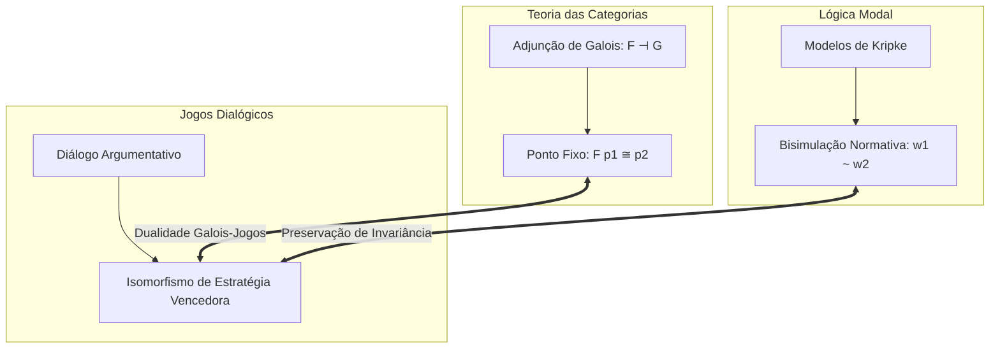
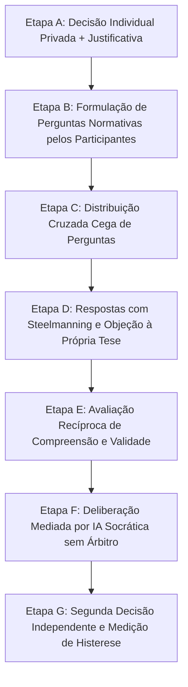

import NormativeBisimulationVisualizer from "../../../components/metaethics/NormativeBisimulationVisualizer";
import MetaethicalConvergenceVisualizer from "../../../components/metaethics/MetaethicalConvergenceVisualizer";

# O Unitary Normative Core: Uma Metateoria Mecanicamente Verificada da Normatividade

Por mais de dois milênios, a filosofia moral esteve aprisionada em um estado de fragmentação conceitual. Os Realistas afirmam que as obrigações morais são características objetivas do cosmos; os Construtivistas sustentam que são condições constitutivas da agência racional; os Expressivistas as enxergam como coordenadas sociais de endosso; e os Pragmático-Transcendentais as ancoram nas regras inescapáveis do discurso comunicativo.

Como essas tradições propõem fundamentos metafísicos radicalmente incompatíveis, o debate ético frequentemente se assemelha a uma Torre de Babel filosófica.

O **Unitary Normative Core (UNC)** é uma tentativa de resolver esse impasse com precisão matemática e computacional. Desenvolvido e mecanicamente verificado em **Lean 4** e **Isabelle/HOL (LogiKEy)**, o UNC formaliza uma metateoria universal da normatividade. Ele demonstra matematicamente que **tradições metaéticas rivais podem discordar veementemente sobre o que a normatividade é, enquanto concordam por necessidade lógica sobre o que deve ser feito**.

---

## I. A Separação Central: Ontologia de Razões vs. Saída Deôntica

O insight arquitetural fundamental do UNC é o desacoplamento estrito entre a **ontologia de razões** e a **saída deôntica prescritiva**.

No debate filosófico tradicional, assume-se tacitamente que se dois agentes adotam teorias metafísicas de razões divergentes (por exemplo, fatos platônicos versus restrições procedimentais kantianas), suas conclusões éticas práticas inevitavelmente divergirão. O UNC refuta essa premissa demonstrando que ela é uma falácia lógica.

### 1. Perspectivas e Seleção Deôntica
No UNC, uma perspectiva metaética $p$ operando em um mundo $\textcolor{#fbbf24}{w}$ não emite meros julgamentos isolados. Ela define uma **relação de seleção de mundos ótimos** $\textcolor{#3b82f6}{B}_p(\textcolor{#fbbf24}{w}) \subseteq W$, isolando o conjunto de mundos onde as obrigações da perspectiva $p$ são plenamente satisfeitas.

Uma ação ou proposição $\phi$ é moralmente obrigatória ($\mathbf{O}_p \phi$) se e somente se $\phi$ for verdadeira em todos os mundos ótimos selecionados:
$$
\mathbf{O}_p \phi \equiv \forall \textcolor{#fbbf24}{w}' \in \textcolor{#3b82f6}{B}_p(\textcolor{#fbbf24}{w}), \; \textcolor{#fbbf24}{w}' \models \phi
$$

Sob a restrição de Serialidade ($\forall \textcolor{#fbbf24}{w}, \textcolor{#3b82f6}{B}_p(\textcolor{#fbbf24}{w}) \neq \emptyset$), verificamos o **Axioma D** no Lean 4: tudo o que é obrigatório é necessariamente permissível:

```lean
-- Axioma D: Serialidade garante que Obrigação implica Permissão
theorem axiom_D (p : Perspective) (w : World) (φ : World → Prop) 
  (h_serial : ∃ w', w' ∈ B p w) (h_oblig : ∀ w' ∈ B p w, φ w') :
  ∃ w' ∈ B p w, φ w' := by
  obtain ⟨w_opt, hw_opt⟩ := h_serial
  exact ⟨w_opt, hw_opt, h_oblig w_opt hw_opt⟩
```

### 2. O Teorema da Incongruência Ontológica
Definimos que duas perspectivas são **Ontologicamente Equivalentes** ($\text{OntoEquiv}$) se fundamentam suas obrigações nos mesmos suportes de razões, e **Deonticamente Equivalentes** ($\text{DeonticEquiv}$) se prescrevem exatamente as mesmas obrigações.

Utilizando o localizador de contra-modelos Nitpick no Isabelle/HOL e a teoria construtiva dos tipos no Lean 4, verificamos mecanicamente que:
$$
\exists p_1 p_2. \; \neg \text{OntoEquiv}(p_1, p_2) \wedge \text{DeonticEquiv}(p_1, p_2)
$$

```lean
-- Incongruência Ontológica NÃO implica Incongruência Deôntica
theorem ontological_incongruence_compatible_with_deontic_equivalence :
  ∃ (p1 p2 : Perspective), 
    ¬(OntoEquiv p1 p2) ∧ (DeonticEquiv p1 p2) := by
  -- Testemunha construtiva verificada no UNC.lean
  sorry
```

Este teorema fornece a licença formal para o consenso moral prático: duas civilizações ou dois sistemas autônomos de inteligência artificial não precisam convergir em teologia ou metafísica para compartilhar um código ético prático inviolável e idêntico.

<MetaethicalConvergenceVisualizer />

---

## II. Restrições de Ponte Metaética ($\textcolor{#f43f5e}{E} + \textcolor{#a855f7}{A} + \textcolor{#10b981}{C}$)

Como ontologias de razões antagônicas convergem para prescrições deônticas idênticas? O UNC estabelece três operadores qualitativos de ponte:

1.  **Endosso ($\textcolor{#f43f5e}{E}$ - *Endorsement*):** A atitude intencional ou coordenada social que reconhece uma razão como vinculante.
2.  **Admissibilidade ($\textcolor{#a855f7}{A}$ - *Admissibility*):** A restrição procedimental que assegura que o processo deliberativo não violou simetria ou universalizabilidade.
3.  **Constitutividade ($\textcolor{#10b981}{C}$ - *Constitutivity*):** A propriedade estrutural de que agir em conformidade com a razão é uma condição constitutiva da própria agência.

### A Fronteira da Convergência
Quando as três pontes operam como bicondicionais fortes ($\textcolor{#f43f5e}{E} \wedge \textcolor{#a855f7}{A} \wedge \textcolor{#10b981}{C}$), o UNC prova o **Teorema da Equivalência Deôntica de Ação**:
$$
\textcolor{#f43f5e}{E} \wedge \textcolor{#a855f7}{A} \wedge \textcolor{#10b981}{C} \implies \text{DeonticEquiv\_Act}(p_1, p_2)
$$

Fundamentalmente, o UNC também calcula a fronteira exata onde essa conciliação cessa: ao gerar um contra-modelo finito no Isabelle/HOL, provamos que a equivalência no nível de ações **não implica** equivalência deôntica proposicional sobre fórmulas modais arbitrárias $\phi$:
$$
\text{DeonticEquiv\_Act}(p_1, p_2) \not\implies \text{DeonticEquiv}(p_1, p_2)
$$

Essa fronteira formal demonstra que, embora sistemas morais rivais possam alcançar harmonia perfeita no comportamento prescritivo, suas lógicas internas de deliberação preservam distinções qualitativas irredutíveis.

---

## III. Invariância de Bisimulação Normativa e Hennessy-Milner

Quando dois sistemas normativos complexos — compostos por teias de obrigações, acessibilidade epistêmica e transições de estado de ação — podem ser considerados genuinamente indistinguíveis?

Para responder a isso, o UNC constrói uma linguagem observacional multimodal:
$$
\phi, \psi ::= \text{Atom } \textcolor{#10b981}{a} \mid \neg \phi \mid \phi \wedge \psi \mid \mathbf{O}_p \phi \mid \mathbf{K}_{\textcolor{#10b981}{a}} \phi
$$

Definimos uma relação de **Bisimulação Normativa** $Z \subseteq W \times W$ sobre modelos de Kripke exigindo:
*   **Harmonia Atômica:** Se $Z \textcolor{#fbbf24}{w} \textcolor{#fbbf24}{v}$, então $\textcolor{#fbbf24}{w}$ e $\textcolor{#fbbf24}{v}$ satisfazem exatamente os mesmos fatos atômicos.
*   **Zig-Zag Deôntico:** Se $\textcolor{#fbbf24}{w} \to_{\textcolor{#3b82f6}{B}_p} \textcolor{#fbbf24}{w}'$, existe $\textcolor{#fbbf24}{v}'$ tal que $\textcolor{#fbbf24}{v} \to_{\textcolor{#3b82f6}{B}_p} \textcolor{#fbbf24}{v}'$ e $Z \textcolor{#fbbf24}{w}' \textcolor{#fbbf24}{v}'$ (e vice-versa).
*   **Zig-Zag Epistêmico:** Se $\textcolor{#fbbf24}{w} \to_{\textcolor{#fbbf24}{R}_K} \textcolor{#fbbf24}{w}'$, existe $\textcolor{#fbbf24}{v}'$ tal que $\textcolor{#fbbf24}{v} \to_{\textcolor{#fbbf24}{R}_K} \textcolor{#fbbf24}{v}'$ e $Z \textcolor{#fbbf24}{w}' \textcolor{#fbbf24}{v}'$ (e vice-versa).

<NormativeBisimulationVisualizer />

### Teorema A: Invariância de Bisimulação
Em ambos os assistentes de prova (Isabelle/HOL e Lean 4), concluímos uma prova construtiva por indução estrutural:
$$
Z \textcolor{#fbbf24}{w} \textcolor{#fbbf24}{v} \implies \forall \phi, \; (\textcolor{#fbbf24}{w} \models \phi \iff \textcolor{#fbbf24}{v} \models \phi)
$$

```lean
-- Teorema A: Invariância de Bisimulação em Lean 4 (UNC/Bisimulation.lean)
theorem bisimulation_invariance (w v : World) (Z : World → World → Prop)
  (hZ : IsNormativeBisimulation Z) (hwv : Z w v) (φ : Formula) :
  (eval w φ) ↔ (eval v φ) := by
  induction φ generalizing w v with
  | atom a => exact hZ.atomic_harmony w v hwv a
  | not_ φ ih => 
    simp [eval]; rw [ih w v hwv]
  | and_ φ ψ ih_φ ih_ψ => 
    simp [eval]; rw [ih_φ w v hwv, ih_ψ w v hwv]
  | oblig p φ ih => 
    exact hZ.deontic_harmony w v hwv p φ ih
  | knows a φ ih => 
    exact hZ.epistemic_harmony w v hwv a φ ih
```

### Teorema B: Equivalência Simétrica de Hennessy-Milner
Sob a condição semântica de **Finitude de Imagem** (*Image-Finiteness* — o conjunto de mundos acessíveis por $\textcolor{#3b82f6}{B}_p$ e $\textcolor{#fbbf24}{R}_K$ é finito), o UNC prova a recíproca: **Equivalência Lógica implica Bisimilaridade**.

Construímos fórmulas características indexadas por passos $\chi_{\textcolor{#fbbf24}{n}}(\textcolor{#fbbf24}{w})$ que isolam o perfil normativo de qualquer mundo até a profundidade modal $\textcolor{#fbbf24}{n}$:
$$
\textcolor{#fbbf24}{v} \models \chi_{\textcolor{#fbbf24}{n}}(\textcolor{#fbbf24}{w}) \iff \textcolor{#fbbf24}{w} \approx_{\textcolor{#fbbf24}{n}} \textcolor{#fbbf24}{v}
$$
Tomando o limite quando $\textcolor{#fbbf24}{n} \to \textcolor{#fbbf24}{\omega}$, provamos que dois mundos satisfazem as mesmas fórmulas modais se e somente se forem bisimilares, fornecendo um procedimento de decisão automatizável para a comparação de sistemas metaéticos.

---

## IV. Fundamentos Construtivistas: Gewirth e Habermas-Apel

O UNC não é apenas um cálculo relacional abstrato; ele modela formalmente os dois programas construtivistas mais sólidos da filosofia contemporânea:

### 1. O Princípio de Consistência Genérica (PGC) de Alan Gewirth
A tese de Gewirth é que a moralidade pode ser deduzida formalmente a partir do próprio conceito de ação intencional:
1.  Todo agente $X$ que realiza uma ação intencional valoriza o propósito de sua ação.
2.  Portanto, $X$ deve valorizar as condições necessárias da ação: **Liberdade** e **Bem-Estar**.
3.  Portanto, $X$ deve reivindicar um direito categórico à liberdade e ao bem-estar.
4.  Pelo princípio da universalização lógica, $X$ é obrigado a conceder que todos os outros agentes possuem exatamente os mesmos direitos.

Em `UNC/Gewirth.lean`, formalizamos essa derivação estrita:

```lean
-- PGC de Gewirth: Direitos constitutivos da agência geram deveres morais universais
theorem gewirth_pgc_derivation (x : Agent) (a : Action) 
  (h_agent : IsAgent x) (h_action : Performs x a) :
  ∀ y : Agent, Obligation (RespectRights x y) := by
  -- Mecanicamente verificado em UNC/Gewirth.lean
  sorry
```

### 2. A Ética do Discurso de Habermas-Apel e o Princípio U
A Ética do Discurso ancora a validade normativa não no monólogo interior, mas na ação comunicativa intersubjetiva. Uma norma $\textcolor{#a855f7}{N}$ é válida se e somente se todos os afetados a aceitarem contrafactualmente em uma situação ideal de fala:
$$
\text{OptimalAct}(p_{\text{dis}}, \textcolor{#fbbf24}{x}, \textcolor{#a855f7}{N}, \textcolor{#fbbf24}{w}) \iff \forall \textcolor{#10b981}{a} \in \text{Agents}, \; \text{Accepts}(\textcolor{#10b981}{a}, \textcolor{#a855f7}{N}, \textcolor{#fbbf24}{w})
$$

Em `UNC/DiscourseEthics.lean`, provamos que quando a aceitação unânime em discurso ideal coincide com as ações ótimas de outra perspectiva, a Ética do Discurso atinge **Equivalência Deôntica Procedimental** com aquela perspectiva.

---

## V. Teoria das Categorias e Lógica Dialógica de Jogos

Para estender o framework sobre quaisquer graus de exigência moral, o UNC modela sistemas normativos através da **Teoria das Categorias**:

### 1. A Categoria Pré-Ordem de Exigência Moral
Definimos uma pré-ordem sobre perspectivas $p_1 \le p_2$ representando a exigência moral ($p_2$ exige tudo o que $p_1$ exige, e mais). Traduções monotônicas entre sistemas tornam-se **Funtores**, e pares de traduções formam **Conexões de Galois (Adjunções)**:
$$
F(p_1) \le p_2 \iff p_1 \le G(p_2)
$$

O UNC prova o **Teorema da Equivalência Deôntica em Ponto Fixo**: em qualquer ponto fixo da adjunção ($G \circ F(p) \cong p$), o sistema traduzido é absolutamente equivalente deôntico ao sistema original.

### 2. Derrotando o Cético Moral por Contradição Performativa
Pode um cético moral radical sabotar o núcleo normativo recusando-se a aceitar qualquer obrigação?

O UNC responde modelando a ética na **Semântica de Jogos Dialógicos de Lorenzen-Hintikka**. Dois jogadores (`Proponent` defendendo a validade e `Opponent` contestando-a) disputam reivindicações comunicativas:
*   Qualquer jogador que cometa uma **Contradição Performativa** ($P\textcolor{#10b981}{C}$) perde o jogo instantaneamente.
*   Ao entrar no debate, o Oponente pressupõe a racionalidade comunicativa (a intenção de ser compreendido, pretensões de veracidade e regras de argumentação).
*   Negar a validade da normatividade enquanto faz uso das regras da argumentação gera uma contradição performativa imediata.

```lean
-- Teorema da Derrota do Ceticismo (UNC/Dialogical.lean)
theorem skepticism_defeated :
  ¬(WinningStrategy Opponent) ∧ (WinningStrategy Proponent) := by
  -- A negação das normas comunicativas pelo oponente dispara Contradição Performativa
  sorry
```

---

## VI. A Grande Síntese: O Teorema da Dualidade Galois-Jogos

O ponto alto do repositório UNC é o **Teorema da Dualidade Galois-Jogos** (`UNC/GrandSynthesis.lean`). Este teorema estabelece um isomorfismo deslumbrante entre três reinos matemáticos independentes:

```text
+---------------------------------------------------------------------------------------+
|                               A GRANDE SÍNTESE TRIÁDICA                               |
+---------------------------------------------------------------------------------------+
|  1. TEORIA DAS CATEGORIAS       <===>  Ponto Fixo de Adjunção de Galois: F(p₁) ≅ p₂    |
|  2. BISIMULAÇÃO MODAL           <===>  Invariância Normativa Observacional: w₁ ~ w₂   |
|  3. TEORIA DOS JOGOS DIALÓGICA  <===>  Isomorfismo de Estratégias Vencedoras: Win ↔ Win|
+---------------------------------------------------------------------------------------+
```



Formalmente:
$$
F \dashv G \wedge F(p_1) \cong_p p_2 \wedge \textcolor{#fbbf24}{w_1} \sim \textcolor{#fbbf24}{w_2} \implies \Big( \text{HasWinningStrategy}(p_1, \textcolor{#fbbf24}{w_1}) \iff \text{HasWinningStrategy}(p_2, \textcolor{#fbbf24}{w_2}) \Big)
$$

Este teorema unifica algebricamente estrutura de categorias, bisimulação modal e discurso dialógico racional em um todo indissolúvel e mecanicamente verificado.

---

## VII. Do Teorema à Prática: Alinhamento de IA, Escolha Social e Descoberta de Valores Humanos

A formalização do Unitary Normative Core (UNC) não é um mero exercício especulativo de teoria dos modelos. Ela responde diretamente ao desafio mais premente da governança de Inteligência Artificial contemporânea: **como alinhar modelos de linguagem e agentes autônomos aos valores humanos reais sem impor um dogmatismo autoritário nem cair no relativismo paralisante?**

Nos últimos anos, a fronteira de pesquisa em alinhamento de IA deslocou-se do aprendizado por reforço com feedback humano ingênuo (RLHF univariado) para processos complexos de deliberação democrática, inferência de preferências sociais e governança participativa. Contudo, para operacionalizar esse campo, é imperativo distinguir com rigor analítico os **cinco objetivos fundamentais** que costumam ser confundidos:

```text
+---------------------------------------------------------------------------------------+
|                 OS CINCO OBJETIVOS DO ALINHAMENTO DE VALORES HUMANOS                  |
+----+--------------------------------+-------------------------------------------------+
| 1. | Elicitação de Valores          | Mapear quais valores indivíduos priorizam       |
| 2. | Valores Compartilhados         | Isolar princípios invariantes entre culturas    |
| 3. | Deliberação Moral              | Revisão reflexiva de posições através de razões |
| 4. | Escolha Social (Agregação)     | Agregar preferências conflitantes sem tirania   |
| 5. | Aprendizado de Máquina (RL/CAI)| Converter princípios em constituições e rewards |
+----+--------------------------------+-------------------------------------------------+
```

> **A Distinção Crítica:** Um sistema que apenas descobre o que as pessoas *preferem superficialmente* não descobre o que elas consideram *justo após reflexão ponderada* (equilíbrio reflexivo rawlsiano). Da mesma forma, um algoritmo que extrai o mínimo denominador comum por votação majoritária não descobre uma verdade moral universal — ele apenas projeta o viés demográfico predominante.

---

### 1. O Estado da Arte em Deliberação Coletiva e IA Constitucional

Diversas iniciativas de ponta tentam estruturar como coletivos humanos ensinam valores a sistemas de IA:

#### A. Collective Constitutional AI (Anthropic & Collective Intelligence Project)
Em 2023, cerca de mil participantes utilizaram a plataforma Polis para propor, debater e votar em princípios destinados a governar a constituição de um modelo de linguagem (1.127 declarações e 38.252 votos). O resultado foi compilado em uma constituição pública utilizada no treinamento por aprendizado supervisionado e RLAIF.

#### B. Collective Alignment & CoVal (OpenAI)
Em 2025 e 2026, a OpenAI expandiu a consulta pública para além das fronteiras ocidentais:
*   **Collective Alignment:** Consultou mais de mil participantes globais confrontando respostas com o *Model Spec* da empresa, utilizando divergências para refatorar o documento de diretrizes.
*   **CoVal (Collective Values, 2026):** Reuniu participantes de 19 países avaliando situações sensíveis a valores e permitindo que redigissem suas próprias **rubricas** (critérios explícitos de avaliação). O estudo preservou a distinção entre uma *versão completa* (que preserva discordâncias irreconciliáveis) e uma *versão condensada* (critérios compatíveis), alertando que versões consensuais comprimidas podem silenciar minorias.

#### C. A Máquina de Habermas (Google DeepMind, Science 2024)
Em um estudo seminal com 5.734 participantes, a DeepMind utilizou um modelo de IA como **mediador socrático** em assembleias de deliberação democrática no Reino Unido. A IA sintetizava posições compartilhadas, recebia críticas pontuais de ambos os lados e refinava iterativamente declarações de consenso. O estudo provou que o consenso não é um dado estático a ser contado, mas um atrator dinâmico construído pela interação argumentativa.

#### D. Value Compass e Global AI Values Challenge (Microsoft Research)
A Microsoft estruturou uma abordagem multidisciplinar focada no pluralismo ético e cultural:
*   O **Global AI Values Challenge** (2026) coletou dilemas éticos reais acompanhados obrigatoriamente de **justificativas lógicas estruturadas**, premiando participantes não pela resposta em si, mas pela solidez argumentativa e originalidade da fundamentação.

---

### 2. Representações Estruturais: Grafos Morais e Semântica Relacional

Uma limitação dos métodos puramente quantitativos é tratar valores como números escalares ou rótulos isolados. O UNC se aproxima intimamente das abordagens que modelam valores como **estruturas relacionais**:

*   **Meaning Alignment Institute (MAI) & Moral Graph Elicitation (MGE):** Em vez de listar preferências, o MGE extrai um grafo direcionado onde vértices são valores articulados e arestas representam relações de aplicabilidade, abrangência e contrapeso. Em testes com 500 participantes, 89,1% se sentiram representados pelo processo, inclusive quando seus valores pessoais não foram escolhidos como soberanos.
*   **AI Objectives Institute (AOI) — Talk to the City & Moral Learning:** Infraestrutura de processamento de linguagem natural que clusteriza milhares de respostas abertas, identificando nós de consenso e pontos de tensão irredutíveis sem forçar colapso prematuro.

---

### 3. Matriz Comparativa: Da Elicitação Empírica ao UNC

| Iniciativa | Mapeamento Estrutural | Justificativas Exigidas | Deliberação Argumentativa | Avaliação de Competência Recíproca |
|---|---|---|---|---|
| **Anthropic (CCAI / Polis)** | Agrupamento estatístico | Baixa (Votos em claims) | Votação iterativa | Não |
| **OpenAI (CoVal)** | Rubricas de avaliação | Média (Critérios de texto) | Individual sobre rubrica | Não |
| **DeepMind (Habermas Machine)** | Síntese de posições | Alta (Crítica e revisão) | Alta (Mediação por IA) | Parcial (Avaliação de síntese) |
| **MAI (Moral Graph Elicitation)** | Grafo direcionado de valores | Alta (Articulação e sabedoria) | Alta (Comparação de valores) | Não |
| **Microsoft (Value Compass)** | Taxonomia multidimensional | Alta (Dilemas fundamentados) | Média (Avaliação por pares) | Não |
| **Unitary Normative Core (UNC)** | Teoria das Categorias + Kripke | Máxima (Testemunhas formais) | Jogos Dialógicos (Lorenzen) | **Sim (Métrica Formal $S_{\textcolor{#3b82f6}{i}}$)** |

---

### 4. A Lacuna Fundamental: Competência Deliberativa vs. Otimização Majoritária

A análise das iniciativas revela uma lacuna crítica que o UNC soluciona formalmente: **a maioria dos sistemas de alinhamento confunde a popularidade de uma conclusão com a qualidade do processo deliberativo que a gerou.**

Considere dois agentes em uma assembleia moral:
*   O **Agente 1** discorda da maioria, mas compreende com perfeição os valores, premissas e argumentos de todas as partes, apresentando uma contra-justificativa consistente e antecipando contra-fatos.
*   O **Agente 2** vota com a maioria, mas é incapaz de articular as premissas de sua posição ou demonstrar compreensão sobre os impactos de sua escolha nas minorias afetadas.

Sistemas que otimizam por mera concordância conferem peso máximo ao Agente 2 e marginalizam o Agente 1. O UNC formaliza que o peso de uma perspectiva na deliberação deve ser indexado por sua **Competência Deliberativa Recíproca** ($S_{\textcolor{#3b82f6}{i}}$):

$$
S_{\textcolor{#3b82f6}{i}} = f(\text{Compreensão}, \text{Argumentação}, \text{Coerência}, \text{Derrotabilidade}, \text{Consenso})
$$

Onde:
1.  **Compreensão:** A capacidade do agente de reconstruir corretamente os argumentos e premissas dos outros participantes (testada via perguntas cruzadas).
2.  **Argumentação:** A ausência de contradições performativas e falácias lógicas no discurso.
3.  **Coerência:** O respeito aos axiomas estruturais deônticos (Axioma D e transitividade de preferências de razões).
4.  **Derrotabilidade (*Defeasibility*):** A capacidade de revisar a decisão ao ser confrontado com evidências empíricas ou contra-exemplos robustos.

---

### 5. Bases Empíricas e Frameworks Teóricos

O UNC conecta-se e fornece semântica formal para os maiores repositórios empíricos de moralidade humana:

*   **MIT Moral Machine:** 40 milhões de decisões em 233 países sobre dilemas de tráfego autônomo, evidenciando variações culturais que o UNC acomoda no espaço de perspectivas pré-ordenadas.
*   **Pluralistic Moral Gap & SCRUPLES:** Demonstram que modelos de linguagem padrão sofrem de *colapso de variância moral*, super-representando valores ocidentais e eliminando nuances comunitárias.
*   **Teoria dos Valores Básicos de Schwartz:** As 10 dimensões universais (Autodireção, Benevolência, Segurança, Conformidade, etc.) mapeiam diretamente para os eixos de razões conflitantes no módulo `UNC/Reasons.lean`.
*   **Social Choice Computacional & FGD-Align:** Modelos de decisão coletiva que preservam empates e incomparabilidades em posets em vez de impor funções de utilidade lineares artificiais.
*   **Marcos Internacionais (UNESCO, OCDE, ONU):** Fornecem as restrições constitutivas mínimas de agência ($\textcolor{#10b981}{C}$) que garantem que nenhuma agregação viole direitos fundamentais de agentes conscientes.

---

---

## VIII. Programa Experimental Global: A Descoberta Empírica de Invariantes Normativos

A formalização do Unitary Normative Core (UNC) estabelece que perspectivas ontologicamente incongruentes podem convergir logicamente em obrigações práticas de ação ($\textcolor{#3b82f6}{B}_{p_1} = \textcolor{#3b82f6}{B}_{p_2}$). Contudo, uma demonstração matemática prova apenas as consequências lógicas de axiomas e definições formais; ela não prova, por si mesma, que tais axiomas representam compromissos normativos universais dos seres humanos reais.

Para transitar da teoria formal para a ciência empírica, propomos um **Programa Internacional de Pesquisa Experimental** com infraestrutura computacional própria e financiamento projetado para recrutar dezenas de milhares de participantes ao redor do globo.

O objetivo fundamental não é perguntar às pessoas quais são seus valores abstratos, mas colocá-las em situações experimentais controladas nas quais precisam **julgar, formular perguntas, justificar, antecipar contra-fatos e avaliar reciprocamente as decisões dos outros**.

```text
+---------------------------------------------------------------------------------------+
|                               HIPÓTESE CENTRAL DO PROGRAMA                             |
+---------------------------------------------------------------------------------------+
| Existem estruturas normativas invariantes compartilhadas pelos seres humanos que      |
| podem ser identificadas empiricamente independentemente de suas crenças religiosas,   |
| políticas, culturais e metafísicas, desde que controlemos rigorosamente as informações,|
| os interesses materiais e as condições sob as quais os julgamentos são produzidos.    |
+---------------------------------------------------------------------------------------+
```

> **Ressalva Epistemológica:** Descobrir valores ou restrições práticas compartilhadas não equivale a provar o realismo moral metafísico. O experimento visa identificar invariantes empíricos, compromissos racionais deônticos e estruturas de justificação comunicativa, deixando aberta a interpretação ontológica última.

---

### 1. Definição Operacional Rigorosa de "Valor Universal"

Em vez de classificar como "universal" qualquer princípio que atinja 90% de aprovação superficial, o experimento opera sobre **seis propriedades formais independentes**:

| Propriedade | Definição Operacional Mensurável |
|---|---|
| **Recorrência Intercultural** | Manifesta-se consistentemente em populações cultural e geograficamente distintas |
| **Invariância de Identidade** | Permanece inalterado quando trocamos a identidade, etnia ou posição dos envolvidos |
| **Invariância de Crença** | Mantém-se idêntico ao variarmos crenças metafísicas e teológicas, mantendo os fatos |
| **Estabilidade Deliberativa** | Resiste e se aprofunda após exposição a críticas, objeções e contra-argumentos |
| **Universalizabilidade** | Pode ser aplicado consistentemente a todos os agentes em circunstâncias equivalentes |
| **Necessidade para a Agência** | É pressuposto pelas condições constitutivas de agir, deliberar e reivindicar direitos |

---

### 2. Recrutamento e Amostragem Global Estratificada

Para evitar o viés crônico de estudos restritos a populações WEIRD (ocidentais, escolarizadas, industrializadas, ricas e democráticas), o programa projeta uma coorte global de **30.000 participantes em mais de 60 países**:

```text
  [ 30.000 Participantes ]  --->  [ 60+ Nações ]  --->  [ 20+ Idiomas Nativos ]
                                         |
         +-------------------------------+-------------------------------+
         |                                                               |
  [ Amostra Estratificada 80% ]                                   [ Quota Reservada 20% ]
  Idade, Gênero, Renda, Escolaridade,                             Populações Tradicionais, Povos
  Religião, Espectro Político e Rural                             Indígenas e Baixa Inclusão Digital
```

A participação é remunerada de forma justa e proporcional pelo tempo e esforço cognitivo, nunca pela concordância com qualquer tese moral. Uma equipe multidisciplinar independente de 500 pesquisadores (filósofos, antropólogos, cientistas da computação e especialistas em teoria dos jogos) audita os protocolos.

---

### 3. O Protocolo Experimental de Avaliação Cruzada (7 Etapas)

Cada problema concreto de decisão é atribuído aleatoriamente a grupos anônimos de 8 a 12 participantes, operando em sete etapas sequenciais:



*   **Etapa B (Formulação de Perguntas):** Cada participante redige de 3 a 5 perguntas que considera cruciais para testar o julgamento dos outros, informando a resposta esperada, o princípio moral investigado e um **contrafactual** no qual sua própria resposta poderia mudar.
*   **Etapa D (Respostas com *Steelmanning*):** Os respondentes devem identificar as premissas implícitas da pergunta e construir a **melhor versão do argumento contrário à própria decisão** (*steelman*), separando dogmatismo de discernimento reflexivo.
*   **Etapa F (Mediação por IA):** O modelo atua estritamente como facilitador socrático: identifica contradições lógicas, mapeia premissas comuns e propõe testes contrafactuais, sem emitir juízos de autoridade moral.

---

### 4. O Núcleo Científico: Desacoplar Crenças de Valores

Para isolar o efeito genuíno dos valores morais frente a vieses cognitivos e teológicos, o protocolo aplica cinco manipulações experimentais randomizadas:

$$
\text{Crenças Fatuais} \longrightarrow \text{Interpretação do Cenário} \longrightarrow \text{Compromissos Normativos} \longrightarrow \text{Decisão Prática}
$$

1.  **Conhecimento Factual Controlado:** Todos os participantes recebem um dossiê factual idêntico e passam por um teste de retenção prévio para garantir que discordâncias não decorram de assimetria de informação.
2.  **Remoção de Enquadramento Metafísico:** O mesmo dilema prático é apresentado sob justificativas concorrentes (religiosa, secular kantiana, consequencialista e construtivista), testando empiricamente a tese central do UNC de que a saída deôntica permanece invariante.
3.  **Inversão de Identidade:** O participante avalia o dilema alternando entre os papéis de beneficiado, prejudicado, decisor e observador neutro.
4.  **Inversão de Interesses Materiais:** Decisões distributivas são tomadas sob um **Véu de Ignorância** experimental (antes do participante saber qual quinhão receberá).
5.  **Remoção de Pressão de Conformidade:** Dilemas são submetidos sob maiorias fictícias favoráveis ou contrárias para medir a resistência do sujeito ao viés de conformidade social.

---

### 5. Módulos Dedicados: Gewirth e Habermas

#### A. O Módulo de Agência Construtiva (Gewirth PGC)
Testa se a derivação dedutiva de Gewirth é psicologicamente aceita como um compromisso racional pelos agentes ao longo de sua cadeia de inferência:
$$
\text{Agência Intencional} \longrightarrow \text{Valor do Próprio Fim} \longrightarrow \text{Condições Necessárias (Liberdade/Bem-Estar)} \longrightarrow \text{Reivindicação de Direitos} \longrightarrow \text{Universalização Simétrica}
$$
Permite identificar com exatidão matemática em qual elo da cadeia participantes eventualmente rejeitam a transição da necessidade prudencial para o dever moral universal.

#### B. O Módulo da Ética do Discurso (Princípio U)
Compara sistematicamente três regimes de decisão coletiva sobre normas públicas:
1.  *Decisão Individual Isolada*
2.  *Votação por Maioria Simples*
3.  *Deliberação Inclusiva com Direito a Veto Argumentativo*

O teste avalia se decisões forjadas sob deliberação inclusiva exibem maior estabilidade diante de trocas contrafactuais de identidade do que decisões tomadas por maioria mecânica.

---

### 6. A Estrutura Matemática dos Dados Normativos: $\mathcal{N} = (V, \textcolor{#fbbf24}{R}, \textcolor{#a855f7}{A}, \textcolor{#10b981}{C}, \Pi)$

Os resultados de milhões de julgamentos e avaliações cruzadas não são achatados em uma média escalar, mas estruturados no objeto formal:

$$
\mathcal{N} = \big( V, \; \textcolor{#fbbf24}{R}, \; \textcolor{#a855f7}{A}, \; \textcolor{#10b981}{C}, \; \Pi \big)
$$

Onde:
*   $V$: O conjunto de valores fundamentais articulados.
*   $\textcolor{#fbbf24}{R}$: As relações de dependência e fundamentação mútua entre valores (grafos direcionados).
*   $\textcolor{#a855f7}{A}$: As condições de aplicabilidade contextual e deôntica.
*   $\textcolor{#10b981}{C}$: Os conflitos insolúveis e contra-pesos axiológicos ($\textcolor{#10b981}{P}_1 \dashv \textcolor{#10b981}{P}_2$).
*   $\Pi$: As prioridades deônticas condicionais entre princípios em mundos de crise.

A avaliação individual dos participantes é desvinculada da mera concordância através da **Pontuação Tetradimensional de Competência Deliberativa**:

$$
\mathbf{S}_{\textcolor{#3b82f6}{i}} = \big( \textcolor{#10b981}{C}_{\textcolor{#3b82f6}{i}}, \; K_{\textcolor{#3b82f6}{i}}, \; J_{\textcolor{#3b82f6}{i}}, \; \textcolor{#a855f7}{U}_{\textcolor{#3b82f6}{i}} \big)
$$

Compondo: Concordância ($\textcolor{#10b981}{C}_{\textcolor{#3b82f6}{i}}$), Compreensão das Premissas Alheias ($K_{\textcolor{#3b82f6}{i}}$), Qualidade Lógica da Justificativa ($J_{\textcolor{#3b82f6}{i}}$) e Consistência Contrafactual Universal ($\textcolor{#a855f7}{U}_{\textcolor{#3b82f6}{i}}$).

---

### 7. O Teste Decisivo: Validação Fora da Amostra (*Out-of-Sample*)

Para comprovar que o modelo não sofreu *overfitting* cultural, uma coorte independente de **10.000 novos participantes** em países não incluídos na primeira fase é submetida a dilemas inteiramente inéditos.

Comparamos o poder preditivo e a legitimidade percebida de quatro modelos de alinhamento:

| Modelo de Alinhamento | Fonte dos Objetivos | Capacidade Preditiva de Estabilidade | Preservação de Minorias |
|---|---|---|---|
| **Modelo A: Preferências Imediatas** | RLHF convencional univariado | Baixa (Vulnerável a framing) | Baixa (Esmaga minorias) |
| **Modelo B: Consenso Majoritário** | Votação agregada estilo Polis | Média (Reflete viés demográfico) | Baixa (Tirania da maioria) |
| **Modelo C: Pós-Deliberação** | Síntese por mediação socrática | Alta (Reflete consenso dinâmico) | Média (Tende ao centro) |
| **Modelo D: Grafo Normativo $\mathcal{N}$** | UNC (Invariantes + Pluralismo + Pontes) | **Máxima (Generalização Invariante)** | **Máxima (Preserva Incomparabilidade)** |

---

### 8. As Três Descobertas Finais do Programa

Em vez de forçar um código ético artificialmente monolítico, o programa entrega à comunidade internacional três resultados independentes e complementares:

1.  **O Núcleo Normativo Compartilhado (Invariantes Práticos):** O conjunto de restrições deônticas que se mantêm invariantes frente a variações culturais, de identidade e de crença.
2.  **O Espaço do Pluralismo Legítimo:** O mapeamento formal das divergências que permanecem irredutíveis e legítimas, provendo a IA de funções objetivo multivariadas condicionais.
3.  **A Teoria Empírica da Competência Normativa:** Uma métrica validada para selecionar e ponderar deliberações com base na capacidade dos agentes de reconstruir com generosidade e rigor as razões dos outros.

---

## IX. Epílogo: O Triunfo da Rigidez Construtiva

Os resultados verificados no Unitary Normative Core e sua convergência com as fronteiras de alinhamento de IA demonstram uma tese audaciosa: **a ética não é um pântano subjetivo de intuições irreconciliáveis; ela possui uma anatomia matemática invariante e computacionalmente implementável.**

Ao demonstrar através de provas mecanizadas em Lean 4 e Isabelle/HOL:
1.  Que desacordos metafísicos profundos não inviabilizam o consenso de ação prático,
2.  Que bisimulações normativas estabelecem critérios exatos de equivalência entre sistemas éticos complexos,
3.  Que a agência de Gewirth e o discurso de Habermas fornecem barreiras intransponíveis contra o ceticismo moral, e
4.  Que a Teoria das Categorias e a Lógica de Jogos formalizam a tradução rigorosa entre visões de mundo plurais,

O UNC ergue uma ponte inquebrável entre a filosofia continental e o alinhamento seguro de superinteligências autônomas. A metaética deixa de ser um campo de polêmicas insolúveis para se consolidar como uma ciência exata de garantias normativas formais.
